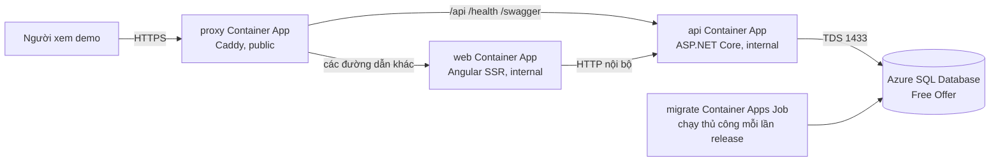

# Triển khai Nomori Marketplace lên Azure cho demo chi phí thấp

> Mục đích của tài liệu này là đưa bản demo lên Internet bằng Azure, với dữ liệu
> nhỏ và ít người dùng. Đây **không phải** cấu hình production. Thực hiện lần đầu
> nên dành một buổi, không làm ngay trước lúc cần thuyết trình.

## 0. Deploy là gì? Hiểu bằng mô hình đơn giản

Hãy hình dung source code là nguyên liệu, Docker image là một chiếc hộp đã đóng
gói nguyên liệu đó cùng môi trường chạy, còn Azure là nơi đặt những chiếc hộp và
cho chúng chạy trên Internet.

Quy trình đầy đủ có các lớp sau:

```text
Source code
   │  Dockerfile: cài dependency, build, chọn lệnh khởi động
   ▼
Docker image (api / web / migrator / proxy)
   │  docker push
   ▼
Container registry (GHCR, Docker Hub, ...)
   │  Azure pull image
   ▼
Container App / Job (một container đang chạy)
   │
   ├── API container: xử lý nghiệp vụ
   ├── Web container: Angular SSR
   ├── Proxy container: cổng vào duy nhất, định tuyến request
   └── Migration job: chạy migration một lần rồi thoát
```

### Dockerfile, Docker Compose và file triển khai khác nhau thế nào?

Đây là ba khái niệm dễ bị gọi lẫn:

| Thành phần | Trả lời câu hỏi nào? | Trong repository này |
|---|---|---|
| `Dockerfile` | “Đóng gói **một loại** chương trình thành image như thế nào?” | `deploy/api.Dockerfile` đóng gói API hoặc migrator; frontend có `Dockerfile` riêng |
| `docker-compose.yml` | “Trên **một máy**, chạy nhiều container nào, nối mạng/volume/port ra sao?” | `deploy/docker-compose.yml` chạy SQL Server, API, web, Caddy và tunnel để test local |
| Lệnh/manifest Azure | “Azure chạy image nào, bao nhiêu replica, port nào public, biến môi trường/secret nào?” | Các lệnh `az containerapp ...` trong tài liệu này; về sau có thể thay bằng Bicep/YAML |

Vì vậy, `docker-compose.yml` **không tự đóng gói image**. Lúc chạy
`docker compose up --build`, Compose gọi các Dockerfile để build image rồi chạy
chúng. Trên Azure, ta build/push image trước; Azure thường chỉ pull image đã có
sẵn trong registry và khởi chạy theo cấu hình Container App.

### Registry là gì?

Registry giống như “kho hàng” dành cho Docker image. Máy của bạn build image ở
local, sau đó `docker push` đưa image lên GHCR. Azure dùng `docker pull` ngầm để
lấy đúng tag, ví dụ `ghcr.io/yourgithub/nomori-api:v1`.

Registry **không phải database** và không lưu dữ liệu người dùng của marketplace.
Database nằm trong Azure SQL. Không đưa `.env`, password, connection string hoặc
dữ liệu thật vào image public.

### Container, app và job khác nhau thế nào?

- **Container** là một tiến trình đang chạy từ image.
- **Container App** là cách Azure quản lý container đó: cấp CPU/RAM, HTTPS,
  scale, restart, log và network.
- **Container Apps Job** là container chạy theo một lần kích hoạt rồi kết thúc.
  `migrator` là job vì migration không cần một web server chạy cả ngày.
- **Replica** là một bản copy đang chạy của app. Demo đặt tối đa một replica và
  cho phép scale về 0 để tránh giữ tài nguyên khi không có người truy cập.

### Proxy có tác dụng gì?

Proxy (ở đây là Caddy) là một “lễ tân” nhận mọi request tại một địa chỉ public rồi
chuyển tiếp đến dịch vụ phù hợp:

```text
https://demo.../api/products  ──► API container
https://demo.../health/ready  ──► API container
https://demo.../storefront    ──► Angular web container
```

Proxy **không làm cho request được miễn kiểm tra hay tự động an toàn hơn**, và
không phải vì “cùng địa chỉ thì không bị chặn”. Lợi ích chính là trình duyệt thấy
FE và BE cùng **origin** (scheme + host + port):

- Cookie đăng nhập được gửi đúng nơi, không phải cấu hình cross-site cookie.
- CSRF protection hoạt động với cùng site.
- Không cần mở API public riêng và viết CORS policy phức tạp.
- Có một URL duy nhất để gửi cho người demo.

API và web vẫn là hai container, chỉ là chúng được nối trong network nội bộ của
Container Apps. Proxy không gộp source code hoặc database vào một image duy nhất.

### Vì sao không cho Angular gọi thẳng API public?

Vẫn có thể làm vậy trong một hệ thống khác, nhưng sẽ phải giải quyết thêm CORS,
cookie `SameSite`/`Secure`, CSRF và hai URL public. Code hiện tại được thiết kế
cho một địa chỉ chung (Compose local cũng dùng Caddy), nên giữ proxy là cách ít
thay đổi nhất khi đưa lên Azure.

### Một lần deploy thực tế diễn ra như thế nào?

1. Lập trình viên sửa code và chạy test.
2. Dockerfile build source thành các image có tag version.
3. Push image lên registry.
4. Khai báo Azure chạy image nào và truyền các biến môi trường/secret nào.
5. Azure tạo revision, khởi động container và cấp URL/HTTPS.
6. Migration job cập nhật database schema.
7. Kiểm tra health endpoint và các luồng chính.

Ở lần cập nhật sau, ta không “copy source code vào Azure” thủ công. Ta build tag
mới, push tag mới, rồi bảo Azure chạy tag mới. Database migration là bước riêng
vì image ứng dụng và dữ liệu database có vòng đời khác nhau.

## 1. Điều quan trọng nhất: “free” không đồng nghĩa với không thể bị tính tiền

Phương án trong tài liệu dùng:

| Thành phần | Vai trò | Cách giới hạn chi phí |
|---|---|---|
| Azure SQL Database Free Offer | Cơ sở dữ liệu SQL Server được Azure quản lý | 100.000 vCore-giây/tháng, 32 GB dữ liệu và 32 GB backup cho mỗi DB; chọn **Auto-pause until next month** khi hết hạn mức |
| Azure Container Apps (Consumption) | Chạy API, web Angular SSR và Caddy reverse proxy | 180.000 vCPU-giây, 360.000 GiB-giây và 2 triệu HTTP request miễn phí mỗi tháng; scale về 0 khi không có truy cập |
| GitHub Container Registry (GHCR) | Nơi lưu Docker image công khai | Không dùng Azure Container Registry vì ACR có thể phát sinh phí |

Các hạn mức trên là chính sách hiện tại ngày **17/10/2026** và có thể thay đổi. Trước khi tạo tài nguyên, đọc lại [Azure SQL free offer](https://learn.microsoft.com/azure/azure-sql/database/free-offer) và [Container Apps billing](https://learn.microsoft.com/azure/container-apps/billing).

Không có cách kỹ thuật nào bảo đảm tuyệt đối hóa đơn luôn bằng 0 khi đã nâng tài khoản sang Pay-As-You-Go. Các nguyên tắc của tài liệu để giảm rủi ro là:

1. Chỉ tạo đúng các tài nguyên được liệt kê; không tạo VM, Azure Container Registry, Application Gateway, VNet, Log Analytics workspace trả phí, Azure Files hay Key Vault.
2. Đặt `max replicas = 1`; các app web/API/proxy đều `min replicas = 0`.
3. Với SQL chọn **Auto-pause until next month**, tuyệt đối không chọn **Continue using database for additional charges**. Lựa chọn sau có thể không đổi ngược lại về Auto-pause.
4. Tạo Budget + cảnh báo ngay sau khi có subscription. Cảnh báo không phải công tắc chặn tiền, nhưng giúp phát hiện sớm.
5. Khi không cần demo nữa, xóa cả Resource Group. Đây là cách chắc chắn nhất để dừng mọi chi phí của tài nguyên bên trong.

Azure yêu cầu số điện thoại và thẻ debit/credit để xác minh danh tính khi đăng ký Free Account. Có thể xuất hiện một khoản giữ chỗ tạm thời từ ngân hàng; Microsoft nói sẽ không tính phí trừ khi chủ động chuyển sang Pay-As-You-Go. Free Account mới thường có 200 USD credit trong 30 ngày; khi credit hết hoặc hết 30 ngày, tài nguyên sẽ bị vô hiệu hóa thay vì tự tính tiếp, nếu chưa nâng cấp. Xem [giải thích chính thức](https://learn.microsoft.com/training/modules/create-an-azure-account/1-introduction) và [spending limit](https://learn.microsoft.com/azure/cost-management-billing/manage/spending-limit).

## 2. Kiến trúc sẽ chạy



Tại sao có ba app thay vì đưa frontend và API thẳng ra Internet?

- `proxy` là **một địa chỉ công khai duy nhất**. Nó điều hướng `/api`, `/health`, `/swagger` đến API, còn các URL khác đến Angular SSR. Nhờ vậy cookie đăng nhập là same-site, không cần thiết lập CORS phức tạp.
- `api` và `web` chỉ có ingress nội bộ: không ai trên Internet mở trực tiếp được chúng.
- `migrate` không phải web server. Nó chạy một lần để tạo/cập nhật schema database rồi thoát.
- Azure Container Apps tự cấp HTTPS cho URL `*.azurecontainerapps.io`; Caddy vẫn đặt `X-Forwarded-Proto: https` cho API, điều bắt buộc để cookie `Secure` và CSRF hoạt động ở môi trường Production.

Mã hiện tại có background job liên tục dò database. Để SQL serverless được nghỉ và không hết quota, Azure demo bắt buộc dùng `Jobs__Enabled=false`. Khi cần chạy job (settlement, reminder, hủy đơn…), vào `/admin/jobs` và bấm **Chạy ngay**.

## 3. Những giới hạn chấp nhận được cho demo này

1. Lần truy cập đầu tiên sau thời gian rảnh có thể chậm: Container Apps scale từ 0 và Azure SQL có thể resume. Nếu trang đầu lỗi/timeout, đợi khoảng một phút rồi tải lại.
2. SQL đạt quota tháng sẽ bị pause đến đầu tháng kế tiếp. Đó là chủ đích để không bị tính thêm phí.
3. Không dùng Azure Files để giữ khóa Data Protection vì đây là dịch vụ storage có thể phát sinh phí. Do đó sau khi API scale-to-zero, đổi revision hoặc restart, toàn bộ phiên đăng nhập cũ sẽ bị đăng xuất. **Không nhập số tài khoản ngân hàng hoặc dữ liệu nhạy cảm thật**: dữ liệu đã mã hóa bởi khóa tạm thời có thể không đọc lại được sau restart.
4. Không có SLA, backup dài hạn hoặc môi trường ổn định như production. Azure SQL Free Offer phù hợp development/POC.
5. Dùng `Production` và SMTP thật nếu chia sẻ URL ra ngoài nhóm. `Development` để lộ mã OTP/xác thực và Swagger, chỉ phù hợp test nội bộ.

Nếu các giới hạn trên không chấp nhận được, dừng ở đây và chọn VPS nhỏ hoặc máy nhóm + Cloudflare Tunnel theo [deployment-guide.md](deployment-guide.md). Không nên cố “vá” tính bền vững bằng các Azure service trả phí mà chưa lập ngân sách.

## 4. Chuẩn bị trước khi bắt đầu

### 4.1 Tài khoản

Tạo hoặc chuẩn bị các tài khoản sau:

- Một Microsoft account cá nhân để đăng ký Azure Free Account tại <https://azure.microsoft.com/free/>.
- Một GitHub account để dùng GitHub Container Registry (có thể dùng account đang chứa source code). Image ở hướng dẫn này là **public**, nên không đưa mật khẩu, `.env`, data thật hay source bí mật vào image.
- Docker Desktop trên máy Windows để build image. Bật WSL2 backend, khởi động Docker và kiểm tra `docker version`.
- Git, hai repository nằm cạnh nhau như cấu hình hiện tại: `nomori-marketplace-backend` và `nomori-marketplace-frontend`.

Tên Azure và GitHub đều dùng chữ thường, số và dấu `-`. Ví dụ tài liệu dùng các tên dưới đây; thay `yourgithub` bằng GitHub username của bạn:

```text
Resource group: nomori-demo-rg
Region:         southeastasia          (có thể chọn region khác Azure cho phép)
ACA environment: nomori-demo-env
SQL server:      nomori-demo-sql-12345  (phải là duy nhất trên toàn Azure)
SQL database:    NomoriMarketplace_Db
Container apps:  nomori-api, nomori-web, nomori-proxy
Container job:   nomori-migrate
GHCR images:     ghcr.io/yourgithub/nomori-api:v1
                 ghcr.io/yourgithub/nomori-web:v1
                 ghcr.io/yourgithub/nomori-proxy:v1
```

### 4.2 Tạo password và các giá trị bí mật

Tạo trước ba giá trị, lưu trong password manager chứ không commit vào Git:

- `SQL_ADMIN_PASSWORD`: password SQL mạnh, ít nhất 8 ký tự, có hoa/thường/số/ký tự đặc biệt. Không dùng dấu cách hoặc `; = " ' $ \` để tránh làm hỏng connection string.
- `SANDBOX_SECRET`: chuỗi ngẫu nhiên dài cho cổng thanh toán thử nghiệm.
- `SMTP_PASSWORD` nếu bật email thật.

Connection string mẫu (chỉ dùng làm biến secret, không đưa vào file `.md`/Git):

```text
Server=tcp:<SQL_SERVER>.database.windows.net,1433;Initial Catalog=NomoriMarketplace_Db;Persist Security Info=False;User ID=<SQL_ADMIN>;Password=<SQL_ADMIN_PASSWORD>;MultipleActiveResultSets=False;Encrypt=True;TrustServerCertificate=False;Connection Timeout=60;
```

`Encrypt=True` buộc kết nối SQL đi qua TLS. `Connection Timeout=60` cho phép request đầu chờ lâu hơn lúc database đang resume.

## 5. Tạo Azure account và hàng rào chi phí

1. Vào <https://azure.microsoft.com/free/>, chọn **Start free**, đăng nhập Microsoft account, xác minh điện thoại/thẻ và hoàn tất đăng ký.
2. Vào <https://portal.azure.com/>. Trên thanh tìm kiếm mở **Subscriptions** và xác nhận subscription Free Trial/Free Account đang `Enabled`.
3. Mở **Cost Management + Billing** → **Cost Management** → **Budgets** → **Add**:
   - Scope là subscription vừa tạo.
   - Amount đặt mức rất thấp mà bạn muốn được cảnh báo (ví dụ 1 USD hoặc mức nhỏ nhất Portal cho phép).
   - Thêm email của bạn cho ngưỡng 50%, 80%, 100%.
4. Trong **Cost Management** → **Cost analysis**, lọc theo Resource group sau mỗi buổi thao tác để thấy có tài nguyên lạ không.
5. Không bấm nâng cấp sang Pay-As-You-Go chỉ để làm theo hướng dẫn. Nếu Azure từ chối tạo một resource do Free Trial giới hạn, dừng lại kiểm tra thay vì đổi gói vội.

## 6. Đóng gói và đẩy image lên GHCR

### 6.1 Đăng nhập GitHub Container Registry

Trong GitHub, tạo Personal Access Token (classic) có quyền `write:packages`, rồi chạy PowerShell tại máy phát triển:

```powershell
$GitHubUser = "yourgithub"
$GitHubToken = "dán-PAT-vào-đây"
$GitHubToken | docker login ghcr.io -u $GitHubUser --password-stdin
```

Không lưu PAT vào script hoặc commit. Sau khi push image đầu tiên, GitHub Packages có thể hỏi thiết lập visibility; đặt package là **Public**. Azure Container Apps khi đó pull image mà không cần giữ registry password.

### 6.2 Tạo Dockerfile nhỏ cho Caddy

`deploy/Caddyfile` là file được mount khi chạy Docker Compose, nhưng Azure Container Apps không mount file local đó. Tạo **một lần** file mới `deploy/azure-proxy.Dockerfile` với nội dung:

```dockerfile
FROM caddy:2-alpine
COPY deploy/Caddyfile /etc/caddy/Caddyfile
```

Đây không chứa bí mật. Có thể commit file này cùng source trong lần thay đổi kế tiếp.

### 6.3 Build, gắn version và push

Mở PowerShell ở thư mục backend. Thay `v1` bằng version mới ở mỗi release (`v2`, `2026-10-17.1`…), không ghi đè tag cũ.

```powershell
$GitHubUser = "yourgithub"
$Version = "v1"

docker build -f deploy/api.Dockerfile --target api `
  -t "ghcr.io/$GitHubUser/nomori-api:$Version" .
docker build -f deploy/api.Dockerfile --target migrator `
  -t "ghcr.io/$GitHubUser/nomori-migrator:$Version" .
docker build -f deploy/azure-proxy.Dockerfile `
  -t "ghcr.io/$GitHubUser/nomori-proxy:$Version" .
docker build -f ..\nomori-marketplace-frontend\Dockerfile `
  -t "ghcr.io/$GitHubUser/nomori-web:$Version" ..\nomori-marketplace-frontend

docker push "ghcr.io/$GitHubUser/nomori-api:$Version"
docker push "ghcr.io/$GitHubUser/nomori-migrator:$Version"
docker push "ghcr.io/$GitHubUser/nomori-proxy:$Version"
docker push "ghcr.io/$GitHubUser/nomori-web:$Version"
```

Ý nghĩa: `build` đóng source và dependencies thành image bất biến; `push` đưa image lên registry để Azure tải về. Image API và migrator đều từ cùng `api.Dockerfile`, nhưng chạy entry point khác nhau.

## 7. Tạo database Free Offer qua Azure Portal

Lần đầu dùng Portal thay vì CLI để nhìn rõ lựa chọn nào có thể gây chi phí.

1. Portal → **Create a resource** → tìm **SQL Database** → **Create**.
2. Chọn subscription hiện tại, **Create new** Resource group `nomori-demo-rg`; đặt Database name `NomoriMarketplace_Db`.
3. Ở Server, chọn **Create new**, đặt tên SQL server duy nhất (ví dụ `nomori-demo-sql-12345`), region khớp với Container Apps, SQL authentication, administrator login ví dụ `nomoriadmin`, và `SQL_ADMIN_PASSWORD`.
4. Ở mục Compute + storage/chọn service tier, tìm **Azure SQL Database free offer** và chọn nó. Nếu Portal không hiện lựa chọn free offer, dừng lại kiểm tra subscription/region, không chọn tier trả phí thay thế.
5. Trong **Free Database Offer**, đặt **Behavior when free limit reached = Auto-pause the database until next month**. Xác nhận max data storage là 32 GB hoặc ít hơn.
6. Networking: chọn public endpoint chỉ cho demo. Sau khi tạo xong sẽ cấu hình firewall ở bước dưới. Review + create.
7. Mở SQL server vừa tạo → **Networking**:
   - Public network access: `Selected networks`.
   - Chọn **Add your client IPv4 address** để máy bạn (SSMS/Azure Data Studio nếu cần) kết nối được.
   - Bật **Allow Azure services and resources to access this server** để Container Apps kết nối được. Cài đặt này rộng hơn phạm vi subscription (rule `0.0.0.0`); vì vậy password SQL phải mạnh và không chia sẻ connection string.
   - Save.

Azure SQL mặc định chặn mọi kết nối. Lý do các rule trên là: một rule cho máy bạn, một rule cho app đang chạy trong Azure. Tham khảo [SQL firewall](https://learn.microsoft.com/azure/azure-sql/database/firewall-create-server-level-portal-quickstart) và [ý nghĩa của Allow Azure services](https://learn.microsoft.com/azure/azure-sql/database/network-access-controls-overview).

## 8. Tạo Container Apps bằng Azure Cloud Shell

Ở Portal, chọn biểu tượng **Cloud Shell** góc trên → chọn **Bash**. Nếu được hỏi tạo storage cho Cloud Shell, hiểu rằng nó có thể là một resource có phí nhỏ; có thể dùng Azure CLI cài local để tránh, hoặc chấp nhận chi phí storage tối thiểu sau khi xem giá. Không tạo Azure Container Registry.

Cập nhật Azure CLI extension trước. Sau đó đặt biến; thay toàn bộ giá trị trong dấu `<...>`:

```bash
az extension add --name containerapp --upgrade

RG="nomori-demo-rg"
LOC="southeastasia"
ENV="nomori-demo-env"
GH_USER="<yourgithub>"
VER="v1"
SQL_SERVER="<nomori-demo-sql-12345>"
SQL_ADMIN="<nomoriadmin>"
SQL_PASSWORD='<SQL_ADMIN_PASSWORD>'
PUBLIC_URL_PLACEHOLDER="https://example.invalid"
DB_CONNECTION="Server=tcp:${SQL_SERVER}.database.windows.net,1433;Initial Catalog=NomoriMarketplace_Db;Persist Security Info=False;User ID=${SQL_ADMIN};Password=${SQL_PASSWORD};MultipleActiveResultSets=False;Encrypt=True;TrustServerCertificate=False;Connection Timeout=60;"

az group create --name "$RG" --location "$LOC"
az containerapp env create --name "$ENV" --resource-group "$RG" --location "$LOC"
```

Không dán lại terminal output hoặc history có password vào issue/chat. Kết thúc Cloud Shell xong, xóa dòng chứa secret khỏi history nếu bạn đã dùng máy dùng chung.

### 8.1 Tạo API nội bộ

```bash
az containerapp create \
  --name nomori-api --resource-group "$RG" --environment "$ENV" \
  --image "ghcr.io/$GH_USER/nomori-api:$VER" \
  --ingress internal --target-port 8080 --min-replicas 0 --max-replicas 1 \
  --cpu 0.25 --memory 0.5Gi \
  --secrets db-connection="$DB_CONNECTION" sandbox-secret='<SANDBOX_SECRET>' \
  --env-vars \
    "ASPNETCORE_ENVIRONMENT=Production" \
    "ASPNETCORE_URLS=http://+:8080" \
    "ASPNETCORE_FORWARDEDHEADERS_ENABLED=true" \
    "Database__ConnectionString=secretref:db-connection" \
    "Payments__Sandbox__Secret=secretref:sandbox-secret" \
    "Jobs__Enabled=false" \
    "Email__Enabled=false"
```

Chưa đặt `PUBLIC_URL` ở API vì chưa biết URL của proxy. Cũng không cần mở API ra Internet: Container Apps cho app trong cùng environment gọi nhau qua tên ngắn `http://nomori-api`.

### 8.2 Tạo web nội bộ và proxy public

```bash
az containerapp create \
  --name nomori-web --resource-group "$RG" --environment "$ENV" \
  --image "ghcr.io/$GH_USER/nomori-web:$VER" \
  --ingress internal --target-port 4000 --min-replicas 0 --max-replicas 1 \
  --cpu 0.25 --memory 0.5Gi \
  --env-vars "PORT=4000" "API_ORIGIN=http://nomori-api" "PUBLIC_URL=$PUBLIC_URL_PLACEHOLDER"

az containerapp create \
  --name nomori-proxy --resource-group "$RG" --environment "$ENV" \
  --image "ghcr.io/$GH_USER/nomori-proxy:$VER" \
  --ingress external --target-port 80 --min-replicas 0 --max-replicas 1 \
  --cpu 0.25 --memory 0.5Gi \
  --env-vars "SITE_ADDRESS=:80" "API_UPSTREAM=http://nomori-api" "WEB_UPSTREAM=http://nomori-web"

PROXY_FQDN=$(az containerapp show --name nomori-proxy --resource-group "$RG" --query properties.configuration.ingress.fqdn --output tsv)
PUBLIC_URL="https://${PROXY_FQDN}"
echo "$PUBLIC_URL"
```

Lưu `PUBLIC_URL` in ra. Đây là URL gửi cho người demo, ví dụ `https://nomori-proxy.<...>.azurecontainerapps.io`; Azure quản lý HTTPS của URL mặc định này. Internal ingress và service discovery qua tên app là chức năng chính thức của Container Apps, xem [kết nối giữa các app](https://learn.microsoft.com/azure/container-apps/connect-apps).

### 8.3 Cập nhật URL công khai cho API và web

```bash
az containerapp update --name nomori-api --resource-group "$RG" \
  --set-env-vars \
    "Seo__SiteBaseUrl=$PUBLIC_URL" \
    "Email__FrontendBaseUrl=$PUBLIC_URL" \
    "Payments__Sandbox__PageBaseUrl=$PUBLIC_URL"

az containerapp update --name nomori-web --resource-group "$RG" \
  --set-env-vars \
    "PORT=4000" "API_ORIGIN=http://nomori-api" "PUBLIC_URL=$PUBLIC_URL"
```

Ba biến API quyết định link email, canonical/sitemap và redirect payment sandbox. Đặt sai sẽ gây link `localhost` hoặc URL cũ.

## 9. Chạy migration lần đầu

Tạo một Container Apps Job manual. Job dùng image migrator và cùng secret connection string với API. Nó tạo migration schema rồi dừng; không chạy định kỳ.

```bash
az containerapp job create \
  --name nomori-migrate --resource-group "$RG" --environment "$ENV" \
  --trigger-type Manual --replica-timeout 1800 --replica-retry-limit 1 \
  --replica-completion-count 1 --parallelism 1 \
  --image "ghcr.io/$GH_USER/nomori-migrator:$VER" --cpu 0.25 --memory 0.5Gi \
  --secrets db-connection="$DB_CONNECTION" \
  --env-vars "Database__ConnectionString=secretref:db-connection"

az containerapp job start --name nomori-migrate --resource-group "$RG"
az containerapp job execution list --name nomori-migrate --resource-group "$RG" --output table
```

Vào Portal → Container Apps Job → `nomori-migrate` → **Execution history** → mở lần chạy mới nhất. Chỉ tiếp tục khi trạng thái `Succeeded`; nếu thất bại, xem log trước. Lỗi phổ biến nhất là SQL firewall hoặc password/connection string sai.

Sau migration, mở `$PUBLIC_URL/health/ready`. Kỳ vọng là `Healthy`. Nếu SQL vừa pause/resume, đợi rồi thử lại.

## 10. Việc cần làm sau lần deploy đầu

1. Mở `$PUBLIC_URL`, đăng ký tài khoản admin.
2. Vì đang Production, cấu hình SMTP trước khi cần email xác thực/OTP thật. Nếu chưa có SMTP, email nằm trong hàng đợi `/admin/emails`; không chuyển về Development cho site public.
3. Cấp quyền Administrator bằng SQL theo mục 6.1 của [deployment-guide.md](deployment-guide.md#61-tạo-admin), dùng Azure Data Studio/SSMS kết nối từ IP đã whitelist.
4. Chạy smoke test:
   - `/health/ready` là `Healthy`.
   - `/storefront` hiển thị được sau hard refresh.
   - Đăng ký/đăng nhập không lỗi 500.
   - `View Source` của trang sản phẩm có title/canonical dùng `$PUBLIC_URL`.
   - Upload một ảnh test nhỏ.
   - `/admin/jobs` chạy tay một job test thành công.
5. Tạo thêm một Budget alert sau khi đã thấy resource group trong Cost Analysis.

## 11. Cập nhật code ở các lần sau

Quy trình release an toàn là: test local → build image mới → push → chạy migration → đổi API/web/proxy sang tag mới → smoke test.

Ví dụ release `v2`:

1. Merge code, chạy test local. Thay `$Version = "v2"` trong phần build/push và push cả bốn image mới.
2. Trong Cloud Shell đặt lại `VER="v2"` rồi cập nhật API trước:

```bash
VER="v2"
az containerapp update --name nomori-api --resource-group "$RG" \
  --image "ghcr.io/$GH_USER/nomori-api:$VER"

az containerapp job update --name nomori-migrate --resource-group "$RG" \
  --image "ghcr.io/$GH_USER/nomori-migrator:$VER"
az containerapp job start --name nomori-migrate --resource-group "$RG"
```

3. Xem Job execution history. Nếu migration thất bại, **không** cập nhật web/proxy tiếp. Sửa migration rồi build tag mới; không sửa schema trực tiếp trên production demo trừ khi đã backup.
4. Khi migration thành công:

```bash
az containerapp update --name nomori-web --resource-group "$RG" \
  --image "ghcr.io/$GH_USER/nomori-web:$VER"
az containerapp update --name nomori-proxy --resource-group "$RG" \
  --image "ghcr.io/$GH_USER/nomori-proxy:$VER"
```

5. Đợi revision mới running, mở URL public và làm smoke test. Nếu update API/web lỗi ở mức application, quay lại tag trước bằng đúng lệnh `update --image ...:v1`. **Không rollback database tùy tiện**: migration thường là một chiều; cần kế hoạch khôi phục DB riêng.

Mỗi `az containerapp update` tạo revision mới. Trong Portal có thể xem revisions, logs và trạng thái. Giữ tag cũ một thời gian để rollback image được; sau demo xóa các package/version không dùng để tránh nhầm lẫn.

## 12. Vận hành cơ bản

| Tình huống | Làm gì |
|---|---|
| Website không lên | Portal → `nomori-proxy` → Revisions and replicas → Logs; sau đó kiểm tra `nomori-web` và `nomori-api` |
| `health/ready` lỗi | Xem log API; kiểm tra Azure SQL Overview xem DB có `Paused`/đã hết free limit không |
| Lần mở đầu chậm | Chờ container/DB khởi động rồi refresh; đây là trade-off của scale-to-zero/free DB |
| Đăng nhập cũ bị logout sau deploy | Bình thường với cấu hình không lưu Data Protection key; đăng nhập lại |
| Email/OTP không gửi | Kiểm tra `Email__Enabled`, SMTP secrets và `/admin/emails`; Production không hiển thị OTP trên màn hình |
| Job nền không tự chạy | Có chủ đích (`Jobs__Enabled=false`); chạy thủ công từ `/admin/jobs` |
| SQL không kết nối được | Kiểm tra firewall `Allow Azure services...`, DB online, và secret `db-connection` |
| Muốn ngừng hoàn toàn | Xóa Resource Group theo bước dưới |

Để xem log bằng CLI:

```bash
az containerapp logs show --name nomori-proxy --resource-group "$RG" --follow
az containerapp logs show --name nomori-api --resource-group "$RG" --follow
```

Không gửi log có connection string/password ra ngoài nhóm. Nếu lộ SQL password hoặc sandbox secret, đổi password trong Azure SQL, cập nhật Container Apps secret và tạo revision mới cho API/migrator.

## 13. Sao lưu và khôi phục

Azure SQL Free Offer có backup do platform quản lý nhưng bị giới hạn; không xem nó là backup chiến lược. Trước migration lớn hoặc khi dữ liệu demo đáng giữ:

1. Từ Azure Data Studio/SSMS, export **bacpac** của `NomoriMarketplace_Db` về máy cục bộ hoặc một nơi lưu trữ do nhóm quản lý.
2. Kiểm tra file export mở được, rồi ghi ngày và tag code tương ứng.
3. Không import/restore thử trực tiếp đè DB demo đang dùng. Tạo database tạm, kiểm tra dữ liệu trước.

Việc dùng Azure Storage để giữ backup có thể phát sinh chi phí; với demo nhỏ, tải bacpac về máy nhóm là cách đơn giản hơn. Không backup dữ liệu thật nhạy cảm vào máy cá nhân không mã hóa.

## 14. Dọn dẹp sau demo

Khi chắc chắn không cần URL và data nữa, Portal → **Resource groups** → `nomori-demo-rg` → **Delete resource group** → gõ đúng tên resource group để xác nhận. Thao tác này xóa SQL Database, Container Apps environment, apps, job, logs gắn với group và **không thể khôi phục** nếu không có backup.

Sau đó kiểm tra:

- Cost Management → Cost analysis: không còn usage mới từ resource group.
- GitHub Packages: xóa các image demo không còn dùng nếu muốn.
- Budget alert có thể giữ hoặc xóa tùy còn subscription không.

Không xóa Resource Group nếu đang muốn giữ database/data demo. Nếu chỉ muốn tạm dừng, Container Apps tự scale về 0 sau khi rảnh; còn SQL serverless tự pause theo chính sách và hạn mức, nhưng vẫn nên theo dõi Cost Analysis.

## 15. Checklist trước khi gửi link demo

- [ ] Azure SQL là **Free Offer** và **Auto-pause until next month**, không phải `Continue using ... charges`.
- [ ] Không có Azure VM, ACR, VNet, Azure Files, Application Gateway hoặc resource ngoài kế hoạch.
- [ ] `nomori-api`, `nomori-web`, `nomori-proxy` đều `min=0`, `max=1`.
- [ ] API có `Jobs__Enabled=false`, `ASPNETCORE_ENVIRONMENT=Production`.
- [ ] `PUBLIC_URL`/SEO/email/payment sandbox là URL `https` của `nomori-proxy`.
- [ ] API và web có internal ingress; chỉ proxy external ingress.
- [ ] SQL password, PAT và SMTP password không nằm trong Git/image/log/chat.
- [ ] Budget alerts đã gửi thử email thành công.
- [ ] Smoke test xong và có tài khoản admin hoạt động.
- [ ] Đã chấp nhận rằng restart có thể logout mọi người và không dùng dữ liệu nhạy cảm thật.

## Nguồn chính thức để kiểm tra lại

- [Azure SQL Database free offer](https://learn.microsoft.com/azure/azure-sql/database/free-offer)
- [FAQ về hạn mức Azure SQL miễn phí](https://learn.microsoft.com/azure/azure-sql/database/free-offer-faq)
- [Billing của Azure Container Apps](https://learn.microsoft.com/azure/container-apps/billing)
- [Ingress cho Azure Container Apps](https://learn.microsoft.com/azure/container-apps/ingress-how-to)
- [Secrets trong Azure Container Apps](https://learn.microsoft.com/azure/container-apps/manage-secrets)
- [Container Apps Jobs qua Azure CLI](https://learn.microsoft.com/azure/container-apps/jobs-get-started-cli)
- [Tránh phát sinh phí với Azure Free Account](https://learn.microsoft.com/azure/cost-management-billing/manage/avoid-charges-free-account)
