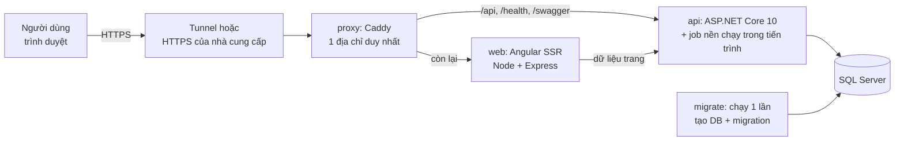

# Nomori Marketplace — Hướng dẫn deploy môi trường test/demo

| | |
|---|---|
| **Mục tiêu** | Một địa chỉ web để cả nhóm (và người xem demo) vào dùng ngay, không phải cài đặt gì |
| **Ưu tiên** | Miễn phí trước; chỉ dùng cách mất phí khi cách miễn phí không đáp ứng được |
| **Người dùng tài liệu** | Nhóm phát triển và nhóm test |
| **File đi kèm** | Backend: `deploy/` (compose, Dockerfile API, Caddyfile, `.env.example`). Frontend: `Dockerfile`, `.dockerignore` |

> **Đã kiểm chứng và chưa kiểm chứng.** Mục 10 nói rõ. Tóm lại: ứng dụng (API, SSR, cấu hình sau proxy) đã được chạy thử thật; các file Docker/Caddy/Cloudflare/Azure **chưa được chạy** vì máy soạn tài liệu không có Docker. Lần đầu chạy hãy dự trù thời gian sửa lỗi nhỏ.

---

## 1. Tóm tắt nhanh

**Khuyến nghị: Phương án A** — chạy cả hệ thống bằng Docker Compose trên **một máy của nhóm** và mở ra Internet bằng **Cloudflare Tunnel** (miễn phí, không cần tài khoản, không cần domain, không cần mở cổng router).

```powershell
# Hai repo nằm cạnh nhau: nomori-marketplace-backend và nomori-marketplace-frontend
cd nomori-marketplace-backend\deploy
copy .env.example .env            # sửa SA_PASSWORD
docker compose up -d --build      # lần đầu 5–10 phút
docker compose --profile tunnel up -d
docker compose logs tunnel        # tìm địa chỉ https://....trycloudflare.com
# điền địa chỉ đó vào PUBLIC_URL trong .env rồi:
docker compose up -d api web
```

Gửi địa chỉ `https://….trycloudflare.com` cho cả nhóm. Xong. Nhược điểm: máy phải bật, địa chỉ đổi mỗi khi tunnel khởi động lại (mục 3).

---

## 2. Hệ thống gồm gì và vì sao ảnh hưởng chuyện chọn nơi deploy



| Đặc điểm của ứng dụng | Hệ quả khi deploy |
|---|---|
| **Chỉ chạy với SQL Server** (SqlClient + T-SQL riêng, FluentMigrator) | Không dùng được PostgreSQL/MySQL miễn phí của các PaaS. Phải có SQL Server thật (container, Azure SQL…) |
| **Job nền chạy trong chính API** (hủy đơn quá hạn, ghi sổ, nhắc nhở, gửi mail) | Nơi deploy "ngủ khi không có người dùng" sẽ làm job ngừng; có thể chạy tay ở `/admin/jobs` |
| **Cookie đăng nhập và CSRF** (`Secure` khi không phải Development) | Phải truy cập qua **HTTPS**, và proxy phải báo `X-Forwarded-Proto: https`; nếu không API trả **500** |
| **Giới hạn tốc độ theo IP** (đăng nhập tối đa 20 lần/phút/IP) | Sau proxy phải bật `ASPNETCORE_FORWARDEDHEADERS_ENABLED=true`, nếu không **cả nhóm dùng chung một IP** và bị chặn lẫn nhau (đã kiểm chứng) |
| **Một địa chỉ cho cả trang và API** (cookie cùng nguồn, không CORS) | Cần reverse proxy (Caddy) đứng trước API và web |
| **Mã hoá số tài khoản ngân hàng và ký cookie bằng khoá data-protection** | Khoá phải nằm trong ổ đĩa bền vững (volume `dp-keys`), mất khoá là mất phiên đăng nhập và không đọc được số tài khoản |
| **Ngoài Development không hiện mã xác thực/OTP** | Môi trường test dùng `Development` (hiện mã trên màn hình) hoặc cấu hình SMTP (mục 7) |
| **SSR cần gọi được API** | Server Angular cần `API_ORIGIN`, và `PUBLIC_URL` để tạo canonical/meta đúng địa chỉ công khai |

---

## 3. So sánh phương án

| | **A. Máy nhóm + Cloudflare Tunnel** | **B. Azure miễn phí** | **C. VPS nhỏ** | Không phù hợp |
|---|---|---|---|---|
| Chi phí | **0 đồng** | 0 đồng trong hạn mức, cần thẻ tín dụng để mở tài khoản | Vài USD/tháng (ước lượng, kiểm tra lại) | — |
| Luôn bật | Khi máy bật | Có (ngủ khi rảnh, mở lại chậm) | Có | |
| Job nền | Chạy bình thường | **Phải tắt** (xem dưới) | Chạy bình thường | |
| Địa chỉ cố định | Không (quick tunnel). Cố định nếu có domain | Có | Có | |
| Độ khó | Thấp | Cao | Trung bình | |
| Hợp với | Test nội bộ, demo ngắn | Muốn không phụ thuộc máy cá nhân | Demo dài hạn, nhiều người | |

**Vì sao chọn A:** là cách duy nhất vừa miễn phí hoàn toàn, vừa chạy đủ SQL Server và job nền, vừa dựng nhanh. Phương án B miễn phí nhưng mất nhiều công và có điểm yếu về job và tốc độ. Phương án C là hướng nâng cấp khi cần ổn định (cùng bộ file `deploy/`, chỉ khác `.env`).

**Những nơi đã xem xét và loại:**

| Dịch vụ | Lý do không phù hợp |
|---|---|
| Render (gói miễn phí) | Không có SQL Server; dịch vụ ngủ sau 15 phút không có truy cập; ổ đĩa tạm thời (mất khi khởi động lại); Postgres miễn phí hết hạn sau 30 ngày |
| Vercel / Netlify / Cloudflare Pages | Chỉ hợp frontend tĩnh/serverless, không chạy ASP.NET + job nền |
| Oracle Cloud Always Free | VM AMD chỉ 1 GB RAM (không đủ SQL Server); VM ARM không chạy được SQL Server; theo các nguồn tin gần đây hạn mức ARM bị giảm |
| Fly.io / Railway / Heroku | Gói miễn phí thay đổi liên tục hoặc chỉ là credit dùng thử; chưa kiểm tra, không nên dựa vào |

---

## 4. Phương án A — Máy của nhóm + Docker Compose + Cloudflare Tunnel (miễn phí)

### 4.1 Yêu cầu máy chủ
- Máy **x64** (Windows 10/11, Linux). Máy Mac chip Apple Silicon: SQL Server chạy giả lập, chậm và dễ lỗi, tránh dùng.
- **Docker Desktop** (Windows dùng WSL2). Cấp cho Docker ≥ **6 GB RAM** (Windows: file `%UserProfile%\.wslconfig`, mục `[wsl2]`, `memory=6GB`, rồi `wsl --shutdown`). Ổ đĩa trống ≥ 10 GB.
- Git. Hai repo `nomori-marketplace-backend` và `nomori-marketplace-frontend` **đặt cạnh nhau** (nếu khác, đặt `FRONTEND_DIR` trong `.env`).
- Cài đặt máy không tự ngủ khi cắm điện; bật Docker Desktop tự chạy khi đăng nhập.

### 4.2 Các bước
1. **Lấy code** (đã merge hai nhánh `chore/deploy`):
   ```powershell
   git clone <repo-backend>  nomori-marketplace-backend
   git clone <repo-frontend> nomori-marketplace-frontend
   ```
2. **Cấu hình:**
   ```powershell
   cd nomori-marketplace-backend\deploy
   copy .env.example .env
   notepad .env
   ```
   Sửa tối thiểu `SA_PASSWORD` (mật khẩu mạnh, không có `; = " ' $ \` hay dấu cách). Các giá trị khác dùng mặc định cho lần đầu.
3. **Chạy:** `docker compose up -d --build`. Thứ tự tự động: SQL Server khởi động → `migrate` tạo DB và áp migration → `api` → `web` → `proxy`.
4. **Kiểm tra trên máy chủ:** mở `http://localhost:8080` (trang cửa hàng), `http://localhost:8080/health/ready` (phải là `Healthy`), `http://localhost:8080/swagger` (chỉ khi `ASPNETCORE_ENVIRONMENT=Development`). `docker compose ps` phải thấy `sqlserver`, `api`, `web`, `proxy` đang chạy; `migrate` đã `Exited (0)`.
5. **Mở ra Internet:**
   ```powershell
   docker compose --profile tunnel up -d
   docker compose logs tunnel          # tìm dòng có https://<tên-ngẫu-nhiên>.trycloudflare.com
   ```
   Điền địa chỉ đó (không có dấu `/` cuối) vào `PUBLIC_URL=` trong `.env`, rồi **tạo lại hai dịch vụ để nhận địa chỉ mới**:
   ```powershell
   docker compose up -d api web
   ```
   `PUBLIC_URL` dùng cho: link trong email, canonical/sitemap, và địa chỉ trang cổng thanh toán thử. Sai địa chỉ → cổng thanh toán thử chuyển hướng về `localhost`.
6. **Tạo admin và dữ liệu** (mục 6), rồi gửi địa chỉ cho cả nhóm.

### 4.3 Giới hạn của quick tunnel (theo tài liệu Cloudflare)
- Dành cho **thử nghiệm**, tối đa 200 request đồng thời, không hỗ trợ SSE (ứng dụng này không dùng SSE).
- **Địa chỉ đổi** mỗi lần container `tunnel` khởi động lại (máy khởi động lại, `down`…). Khi đổi phải làm lại bước 5.
- **Muốn địa chỉ cố định (vẫn miễn phí phần tunnel):** cần một tên miền của bạn và tài khoản Cloudflare miễn phí; tạo "named tunnel" trong bảng điều khiển, lấy token, đổi `command` của dịch vụ `tunnel` thành `tunnel --no-autoupdate run --token <TOKEN>` và đặt `PUBLIC_URL=https://tên-bạn`. Tên miền thường là khoản phí duy nhất (khoảng vài USD/năm).

### 4.4 Mỗi tester một bộ riêng hay dùng chung?
`master-test-plan.md` khuyến nghị mỗi người một DB riêng. Có hai cách:
- **Dùng chung một môi trường:** đơn giản nhất, theo quy tắc cô lập mục 5.3 của kế hoạch test (tiền tố dữ liệu `A-`, `B-`, `C-`; chỉ chủ module đổi cài đặt toàn cục).
- **Ba bộ riêng trên cùng máy** (cần ~8 GB RAM cho Docker hoặc 3 máy): mỗi người một file env và một tên dự án, ví dụ `docker compose -p nomori-a --env-file .env.a up -d` với `HTTP_PORT=8081`, `HTTP_PORT=8082`… và mỗi bộ một tunnel.

---

## 5. Phương án B — Azure miễn phí (Azure SQL Free + Container Apps)

> Chỉ nên làm khi **không thể** dùng máy của nhóm. **Chưa chạy thử**; đây là lộ trình dựa trên tài liệu của Microsoft.

**Gồm:** Azure SQL Database free offer (theo Microsoft: mỗi cơ sở dữ liệu miễn phí 100.000 vCore-giây, 32 GB dữ liệu và 32 GB sao lưu mỗi tháng) và Azure Container Apps (gói tiêu thụ miễn phí hằng tháng 180.000 vCPU-giây, 360.000 GiB-giây, 2 triệu request; mặc định tự thu về 0 khi không có truy cập).

**Điểm yếu bắt buộc phải biết:**
1. **Phải đặt `JOBS_ENABLED=false`.** Bộ chạy job truy vấn DB mỗi 30 giây nên DB serverless không bao giờ tự tạm dừng và hết hạn mức 100.000 vCore-giây chỉ sau vài ngày. Khi cần, vào `/admin/jobs` bấm "Chạy ngay".
2. Khi hết hạn mức, chọn chế độ **tự tạm dừng** (`AutoPause`) để không bị tính tiền; DB dừng đến đầu tháng sau.
3. **Khởi động nguội chậm:** DB tạm dừng mất vài chục giây để mở lại, container thu về 0 mất vài giây. Request đầu tiên có thể chậm hoặc lỗi; đặt chuỗi kết nối `Connection Timeout=60`.
4. Cần thẻ tín dụng để mở tài khoản Azure (xác minh).

**Lộ trình (tóm tắt):**
1. Tạo máy chủ và DB miễn phí: `az sql server create …`, rồi `az sql db create … --use-free-limit --free-limit-exhaustion-behavior AutoPause`; mở tường lửa cho dịch vụ Azure và cho IP của bạn (để chạy migrator).
2. Build và đẩy ba image lên một registry công khai miễn phí (ví dụ GitHub Container Registry): API (`--target api`), migrator (`--target migrator`) và web (`Dockerfile` của frontend). Azure Container Registry **mất phí**, tránh.
3. Chạy migrator một lần từ máy bạn với `Database__ConnectionString` trỏ vào Azure SQL.
4. Tạo Container Apps environment và ba app: `api` và `web` (ingress **nội bộ**, `min-replicas 0`, `max-replicas 1`) và `proxy` (image `caddy:2-alpine` kèm Caddyfile, ingress **công khai**; đặt `SITE_ADDRESS=:80`, `API_UPSTREAM=http://api`, `WEB_UPSTREAM=http://web`). Truyền các biến môi trường ở mục 7 (đặt `Jobs__Enabled=false`).
5. `PUBLIC_URL` là địa chỉ HTTPS của app `proxy`.

---

## 6. Sau khi deploy: tạo admin, dữ liệu mẫu, kiểm tra nhanh

Hệ thống **không có admin mặc định** và **không có dữ liệu mẫu**.

### 6.1 Tạo admin
1. Trên trang web, đăng ký tài khoản (ví dụ `admin@test.local`). Ở môi trường `Development`, mã xác thực email hiện ngay trên màn hình; nếu dùng `Production`, cấu hình SMTP hoặc đánh dấu đã xác thực bằng SQL bên dưới.
2. Cấp quyền (chạy trên máy chủ). Mở shell trong container SQL:
   ```powershell
   docker compose exec sqlserver bash
   ```
   rồi trong shell đó:
   ```bash
   /opt/mssql-tools18/bin/sqlcmd -C -S localhost -U sa -P "$MSSQL_SA_PASSWORD" -I -d NomoriMarketplace_Db -Q "
   UPDATE Customer SET EmailVerified = 1, EmailVerifiedOnUtc = SYSUTCDATETIME() WHERE Email = 'admin@test.local';
   INSERT INTO CustomerCustomerRoleMapping (CustomerId, CustomerRoleId)
   SELECT c.Id, r.Id FROM Customer c CROSS JOIN CustomerRole r
   WHERE c.Email = 'admin@test.local' AND r.SystemName = 'Administrator'
     AND NOT EXISTS (SELECT 1 FROM CustomerCustomerRoleMapping m WHERE m.CustomerId = c.Id AND m.CustomerRoleId = r.Id);"
   ```
   Cờ `-I` là bắt buộc (bảng có chỉ mục lọc). Đăng xuất rồi đăng nhập lại để nhận quyền.

### 6.2 Dữ liệu mẫu
Các tài khoản, shop, sản phẩm, mã giảm giá mẫu được thiết kế ở mục 7 của `docs/testing/master-test-plan.md`; script dựng sẽ có trong `seed-baseline.md` (bước sau). Trong lúc chờ, tạo tay qua giao diện: admin duyệt đơn mở shop, shop tạo sản phẩm, đặt phí ship.

### 6.3 Kiểm tra nhanh (smoke, 5 phút)
| Kiểm tra | Cách | Kỳ vọng |
|---|---|---|
| API sống | `/health/ready` | `Healthy` |
| Trang cửa hàng | `/storefront` | Tải được, đổi ngôn ngữ en/vi giữ nguyên sau khi tải lại |
| Đăng ký + đăng nhập | Tạo tài khoản, đăng nhập | Vào được `/customer/profile`; **không** lỗi 500 |
| Không dùng chung IP | Hai người đăng nhập sai liên tục từ hai mạng | Không chặn lẫn nhau (429 chỉ khi một IP quá 20 lần/phút) |
| Cổng thanh toán thử | Bật `sandbox_redirect` ở `/admin/payments`, đặt hàng | Chuyển tới `PUBLIC_URL/payments/sandbox/…`, không phải `localhost` |
| SEO / SSR | Xem nguồn trang sản phẩm (View Source), `/sitemap.xml`, `/robots.txt` | Có `<title>`, canonical dùng `PUBLIC_URL`; sitemap liệt kê sản phẩm đang bán |
| Job | `/admin/jobs` → "Chạy ngay" `settlement.record_entries` | Chạy thành công |
| Ảnh | Shop tải ảnh sản phẩm | Hiển thị lại được sau khi khởi động lại `api` |

---

## 7. Biến môi trường

Đặt trong `deploy/.env` (compose truyền vào đúng chỗ). Khi triển khai bằng cách khác, đặt tương ứng cho từng dịch vụ.

| Biến (.env) | Biến trong ứng dụng | Ý nghĩa |
|---|---|---|
| `SA_PASSWORD` | `Database__ConnectionString` | Mật khẩu `sa` của SQL Server; chuỗi kết nối được ghép sẵn trong compose |
| `PUBLIC_URL` | `Seo__SiteBaseUrl`, `Email__FrontendBaseUrl`, `Payments__Sandbox__PageBaseUrl`; web: `PUBLIC_URL` | Địa chỉ công khai (không có `/` cuối) |
| `ASPNETCORE_ENVIRONMENT` | giống tên | `Development` (hiện mã xác thực, có Swagger; **chỉ cho dữ liệu thử**) hoặc `Production` |
| `JOBS_ENABLED` | `Jobs__Enabled` | `false` để tắt job nền (bắt buộc với DB tính phí theo mức dùng) |
| `SANDBOX_SECRET` | `Payments__Sandbox__Secret` | Khoá ký callback cổng thanh toán thử |
| `EMAIL_ENABLED`, `SMTP_HOST`, `SMTP_PORT`, `SMTP_USER`, `SMTP_PASSWORD`, `SMTP_FROM` | `Email__*` | Gửi email thật; để trống thì thư nằm hàng đợi `/admin/emails` |
| `SITE_ADDRESS` | Caddy | `:80` sau tunnel; tên miền để Caddy tự lấy HTTPS |
| `HTTP_PORT`, `HTTPS_PORT` | cổng trên máy chủ | Mặc định 8080/8443; VPS có tên miền dùng 80/443 |
| `MSSQL_PID`, `MSSQL_MEMORY_LIMIT_MB` | SQL Server | `Express` (miễn phí cho mọi mục đích, DB tối đa 10 GB) hoặc `Developer` (miễn phí, **chỉ để thử nghiệm**) |
| `FRONTEND_DIR` | build web | Thư mục repo Angular |
| (cố định trong compose) | `ASPNETCORE_FORWARDEDHEADERS_ENABLED=true` | Tin `X-Forwarded-For/Proto` của proxy; **không được bỏ** |
| (cố định trong compose) | web: `API_ORIGIN=http://api:8080` | Nơi server Angular gọi API |

**Email miễn phí để thử:** có thể dùng dịch vụ SMTP miễn phí (Gmail với mật khẩu ứng dụng, hoặc các dịch vụ có gói miễn phí như Brevo, Mailtrap); điền vào `SMTP_*` và `EMAIL_ENABLED=true`. Nhớ rằng OTP, xác thực email và quên mật khẩu gửi **trực tiếp** (không qua hàng đợi), nên lỗi SMTP làm các chức năng này lỗi.

---

## 8. Bảo mật khi cho nhiều người vào

Môi trường này dùng cho **dữ liệu thử**. Không nhập dữ liệu thật của khách hay thông tin ngân hàng thật.

- Chế độ `Development` mở Swagger và hiện mã xác thực/OTP/quên mật khẩu trong phản hồi: ai biết địa chỉ cũng tạo được tài khoản và xác thực. Nếu demo cho người ngoài nhóm, chuyển `Production` + SMTP.
- Không mở cổng SQL (1433) ra ngoài; compose mặc định **không** công bố cổng này. Muốn dùng SSMS trên máy chủ, thêm `ports: ["127.0.0.1:1433:1433"]` cho dịch vụ `sqlserver`.
- Đặt mật khẩu `sa` mạnh; đừng commit `.env`; đổi `SANDBOX_SECRET`.
- Quick tunnel làm lộ máy bạn ra Internet qua một địa chỉ ngẫu nhiên: đừng chia sẻ công khai. Muốn chặn người lạ, thêm `basic_auth` của Caddy (một mật khẩu chung cho cả site) hoặc dùng Cloudflare Access (cần named tunnel).
- Khoá data-protection nằm trong volume `dp-keys`; `docker compose down -v` sẽ xoá (mất phiên đăng nhập và số tài khoản ngân hàng đã mã hoá).
- File `appsettings.Development.json` trong repo có địa chỉ Gmail cá nhân; đừng đặt mật khẩu vào file trong repo.

---

## 9. Vận hành

| Việc | Lệnh |
|---|---|
| Xem trạng thái | `docker compose ps` |
| Xem log | `docker compose logs -f api` (hoặc `web`, `proxy`, `sqlserver`, `tunnel`) |
| Cập nhật phiên bản mới | `git pull` ở cả hai repo, rồi `docker compose up -d --build` (migration tự chạy) |
| Dừng (giữ dữ liệu) | `docker compose stop` / `docker compose start` |
| Xoá sạch dữ liệu để test lại từ đầu | `docker compose down -v` rồi `docker compose up -d --build` (xoá DB và khoá data-protection) |
| Sao lưu DB | `docker compose exec sqlserver bash`, rồi trong shell: `/opt/mssql-tools18/bin/sqlcmd -C -S localhost -U sa -P "$MSSQL_SA_PASSWORD" -Q "BACKUP DATABASE NomoriMarketplace_Db TO DISK='/var/opt/mssql/nomori.bak' WITH INIT"`; lấy file ra: `docker compose cp sqlserver:/var/opt/mssql/nomori.bak .` |
| Chạy job tay | `/admin/jobs` → "Chạy ngay" |

Sau khi máy khởi động lại: Docker tự chạy lại các dịch vụ (`restart: unless-stopped`) nhưng **tunnel đổi địa chỉ**; cập nhật `PUBLIC_URL` và `docker compose up -d api web`.

---

## 10. Đã kiểm chứng và chưa kiểm chứng

**Đã chạy thật (máy Windows, SQL Server LocalDB, ứng dụng đã publish):**
- `dotnet publish` API và migrator thành công; migrator tạo DB và áp toàn bộ migration trên DB trống; API khởi động ở cả `Development` và `Production` với các biến môi trường Email để trống như trong compose.
- Ở `Production`: đăng ký không trả mã xác thực; **không có `X-Forwarded-Proto: https` thì endpoint CSRF trả 500**; có header thì 200 và cookie `Secure`; Swagger tắt.
- Giới hạn tốc độ tính **theo địa chỉ chuyển tiếp** khi bật `ASPNETCORE_FORWARDEDHEADERS_ENABLED`: một IP bị chặn sau 20 lần, IP khác không bị ảnh hưởng.
- Server Angular (bản build thật): dữ liệu trang được lấy qua địa chỉ nội bộ dù yêu cầu đến bằng tên miền công khai; canonical và `og:url` dùng `PUBLIC_URL`; 301/404 và sitemap/robots đúng. (Phát hiện và sửa một lỗi: trước đây server dựng URL từ header `Host` nên khi sau proxy sẽ gọi vòng ra Internet.)
- `docker-compose.yml` đúng cú pháp YAML (đã phân tích), `ng build`, eslint và test Angular đều qua.

**Chưa chạy (cần thử lần đầu trên máy có Docker):**
- `docker compose build/up`: Dockerfile API và web, image `mcr.microsoft.com/mssql/server:2022-latest`, kiểm tra sức khoẻ SQL Server, thứ tự khởi động.
- Caddyfile (cú pháp `trusted_proxies`, biến `{$API_UPSTREAM:api:8080}`), Cloudflare quick tunnel, mọi thứ ở Phương án B và C.
- Hiệu năng khi nhiều người cùng dùng; thời gian khởi động SQL Server trong Docker trên máy yếu.

---

## 11. Sự cố thường gặp

| Triệu chứng | Nguyên nhân thường gặp | Cách xử lý |
|---|---|---|
| `sqlserver` thoát ngay hoặc `unhealthy` | Mật khẩu `sa` không đủ mạnh; Docker thiếu RAM (< 2 GB) | Đặt mật khẩu theo mục `.env.example`; tăng RAM Docker; xem `docker compose logs sqlserver` |
| `migrate` lỗi "Login failed" | `SA_PASSWORD` có ký tự đặc biệt làm hỏng chuỗi kết nối | Dùng mật khẩu chỉ gồm chữ, số, `_ - !` |
| Đăng nhập/đăng ký trả **500** | Request đến API mà không có `X-Forwarded-Proto: https` (bỏ qua Caddy, hoặc proxy khác chưa báo) | Đi qua Caddy; hoặc đặt `ASPNETCORE_ENVIRONMENT=Development` cho môi trường thử |
| **429** khi nhiều người đăng nhập | Thiếu `ASPNETCORE_FORWARDEDHEADERS_ENABLED=true`, mọi người cùng một IP | Giữ nguyên cấu hình compose; kiểm tra `docker compose exec api env \| findstr FORWARDED` |
| Trang tải được nhưng không có sản phẩm trong HTML nguồn | `web` không gọi được API | Kiểm tra `API_ORIGIN`, `docker compose logs web`, `docker compose ps api` |
| Link email, canonical, trang cổng thanh toán trỏ `localhost` | `PUBLIC_URL` chưa đặt hoặc chưa tạo lại `api`/`web` | Sửa `.env`, `docker compose up -d api web` |
| Đăng xuất mất phiên sau khi khởi động lại API | Volume `dp-keys` bị xoá | Giữ volume; không dùng `down -v` trừ khi muốn xoá sạch |
| Địa chỉ `trycloudflare.com` không mở được | Tunnel đã khởi động lại, địa chỉ cũ chết | `docker compose logs tunnel` lấy địa chỉ mới |
| Upload ảnh lỗi | Mặc định ảnh lưu trong DB (giới hạn 5 MB/ảnh) | Dùng ảnh nhỏ hơn; MinIO/S3 là tuỳ chọn, không cần cho môi trường thử |

---

## 12. Nguồn (kiểm tra ngày soạn tài liệu; chính sách miễn phí có thể đổi, hãy xem lại trước khi dựa vào)

- Azure SQL Database free offer: https://learn.microsoft.com/azure/azure-sql/database/free-offer
- Azure Container Apps pricing (gói miễn phí hằng tháng, thu về 0): https://azure.microsoft.com/pricing/details/container-apps/
- Render — Deploy for Free (ngủ sau 15 phút, 750 giờ/tháng, ổ đĩa tạm): https://render.com/docs/free
- Cloudflare Quick Tunnels (`trycloudflare`): https://developers.cloudflare.com/cloudflare-one/networks/connectors/cloudflare-tunnel/do-more-with-tunnels/trycloudflare/
- Oracle Always Free Resources: https://docs.oracle.com/en-us/iaas/Content/FreeTier/resourceref.htm
