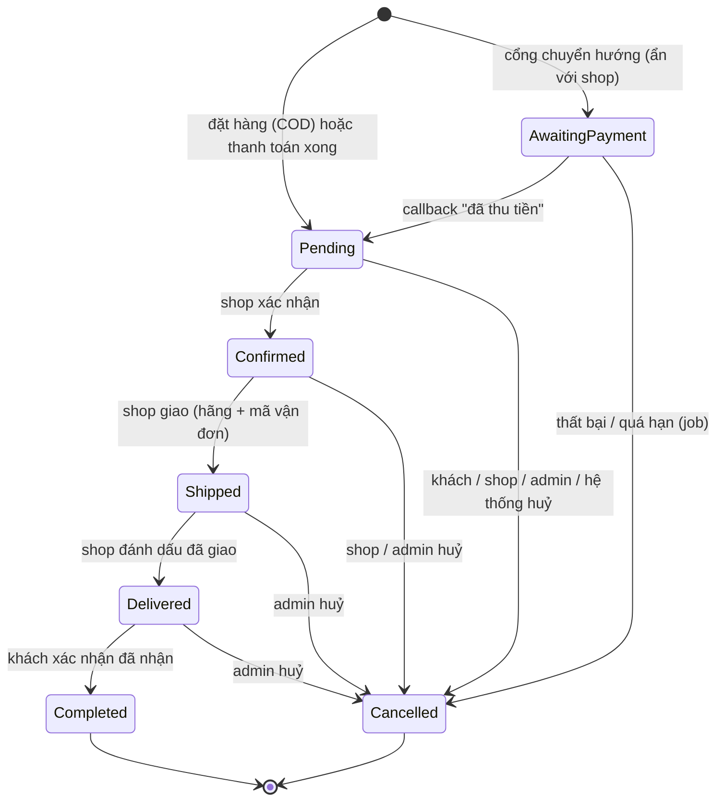
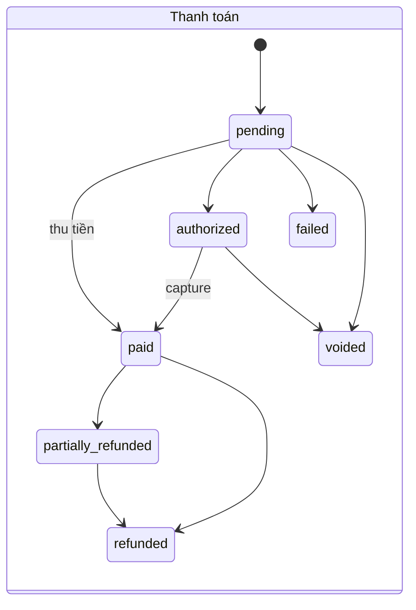
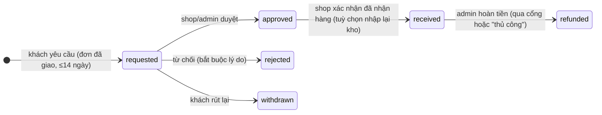
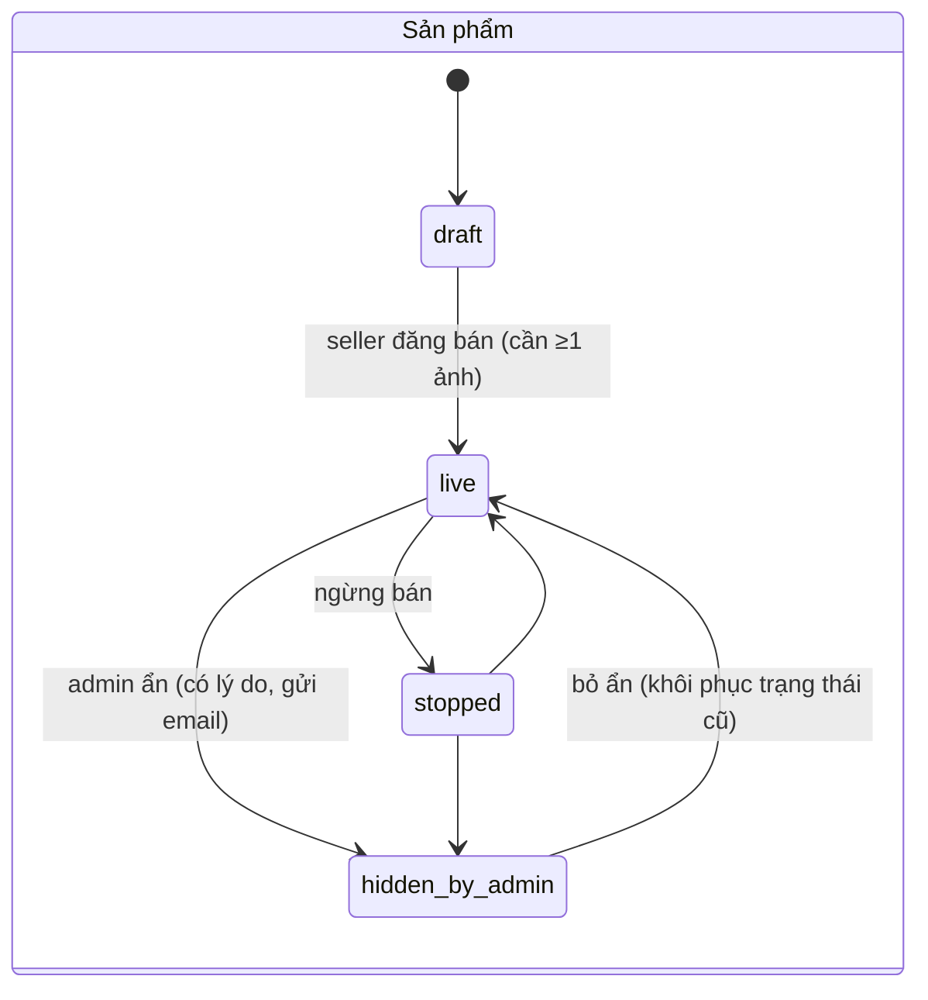
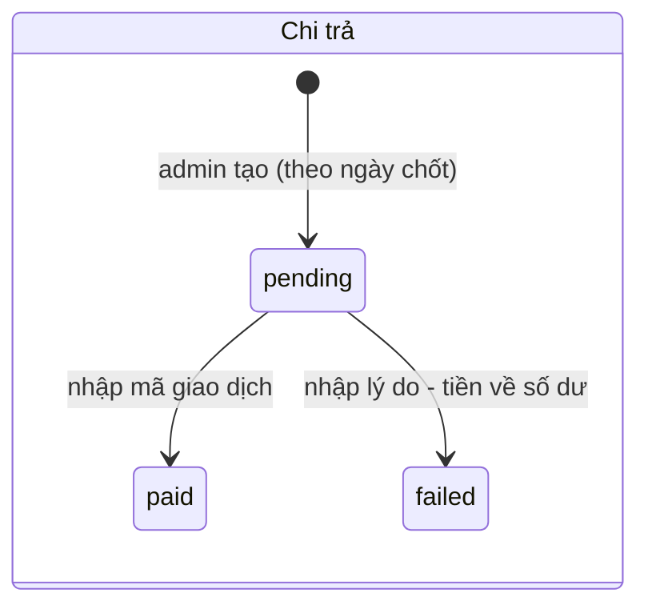
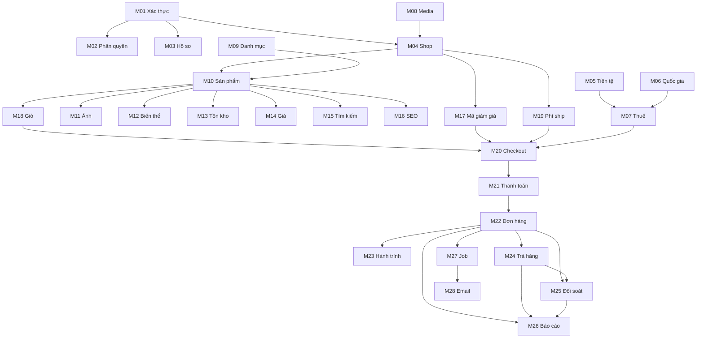

# Nomori Marketplace — Kế hoạch test tổng thể (Master Test Plan)

| | |
|---|---|
| **Phiên bản** | 1.0 (bản đầu, để nhóm thống nhất trước khi sinh tài liệu test từng module) |
| **Ngày** | 2026-10-11 |
| **Phạm vi** | Backend (ASP.NET Core 10 + SQL Server) và Frontend (Angular, có SSR) tại thời điểm sau PR #42 (SEO) |
| **Người dùng tài liệu** | Nhóm 3 người test (Tester A, B, C) |
| **Tài liệu liên quan** | `docs/feature-progress.md` (tiến độ), `docs/modules/*.md` (thiết kế từng module), `docs/auth-authorization-test-guide.md` (hướng dẫn test auth cũ), `nopCommerce/docs/nomori-complete-feature-map.md` (bản đồ tính năng nguồn) |

> **Cách đọc:** mục 1–2 cho biết hệ thống có gì và chạy thế nào. Mục 3–5 là workflow và bản đồ module. Mục 6–7 là cách chia việc cho 3 người và dữ liệu nền. Mục 8–11 là chiến lược test, test xuyên module, vùng rủi ro và những thứ **chưa làm (đừng báo là lỗi)**. Mục 12 là danh sách file `.md` chi tiết sẽ sinh ở bước sau.
>
> **Lưu ý trung thực về độ tin cậy:** phần lớn module mới chỉ có unit test (nhanh, dùng dữ liệu giả) và đã được chạy tay một lần trên SQL Server qua HTTP theo đường "vui vẻ" (thanh toán COD). **Chưa có ai mở các màn hình Angular của nhiều module mới trên trình duyệt.** Vì vậy kỳ vọng thực tế là sẽ tìm ra lỗi, nhất là lỗi giao diện và lỗi nối giữa các module.

---

## 1. Hiện trạng: đã làm những gì (so với nopCommerce 5.00)

Nguồn: `nomori-complete-feature-map.md` (F00–F31) đối chiếu với `feature-progress.md`. Trạng thái: **Xong** = đủ phạm vi slice đã chọn; **Một phần** = còn slice con chưa làm; **Hoãn/Chưa** = chưa có.

> Hệ thống **không** port nguyên nopCommerce: nopCommerce là MVC + Razor; Nomori là REST API + Angular tách riêng, thêm khái niệm **sàn nhiều shop (marketplace)** mà nopCommerce không có. Mọi thứ liên quan "đúng như nopCommerce" cần hiểu là "đúng theo luật nghiệp vụ trong tài liệu `docs/modules/`", không phải giống từng chi tiết.

### 1.1 Các nhóm chức năng đã có

| Mã | Nhóm | Trạng thái | Những gì đã có | Những gì **chưa** có |
|---|---|---|---|---|
| F00–F01 | Nền tảng, cấu hình | Xong | API chuẩn, health `/health/live`, `/health/ready`, migration FluentMigrator, cấu hình qua `IOptions` | Cài đặt lưu trong DB (settings runtime) |
| F02 | Xác thực | Một phần | Đăng ký, đăng nhập mật khẩu, khoá tài khoản, xác thực email, OTP email, quên/đặt lại mật khẩu, đổi mật khẩu, đổi email | Đăng nhập bên thứ ba, MFA app (authenticator) |
| F03 | Phân quyền | Xong | Vai trò, quyền, ánh xạ quyền, audit log | — |
| F04 | Hồ sơ khách | Một phần | Hồ sơ, avatar, sổ địa chỉ, thuộc tính, dữ liệu tài khoản | GDPR (xuất/xoá dữ liệu), tin nhắn riêng |
| F05 | Shop (vendor) | Một phần | Đăng ký mở shop → admin duyệt, quản trị vendor, thành viên shop, cài đặt shop (logo…), **F05-S đối soát**: hoa hồng, sổ bút toán, tài khoản ngân hàng, chi trả | Hoa hồng theo danh mục, phí khác, chi trả tự động |
| F06 | Multi-store | **Hoãn** | — (sàn một domain) | Toàn bộ |
| F07 | Tiền tệ, quốc gia, thuế | Một phần | Tiền tệ chính + hiển thị theo tỷ giá nhập tay, quốc gia/tỉnh + quy tắc địa chỉ, thuế theo nhóm × quốc gia/tỉnh | Giá đã gồm thuế, thuế phí ship, múi giờ, đơn vị đo, đa ngôn ngữ dữ liệu |
| F08 | Media | Một phần | Upload ảnh có kiểm soát (DB hoặc S3/MinIO presigned) | Thumbnail, quét mã độc, file riêng tư/download |
| F09 | Danh mục, thương hiệu | Một phần | Cây danh mục, thương hiệu, cờ cấm seller dùng danh mục | Trang danh mục/thương hiệu công khai riêng |
| F10 | Sản phẩm | Một phần | Quyền sở hữu theo shop, vòng đời 4 trạng thái, mô tả HTML lọc an toàn, SKU/GTIN, lịch đăng bán, sản phẩm liên quan, copy sản phẩm | Kiểm duyệt trước khi đăng (review flow đầy đủ) |
| F11 | Biến thể/thông số | Một phần | Ảnh sản phẩm có thứ tự, biến thể (≤3 thuộc tính, ≤100 tổ hợp), thông số kỹ thuật, tag | Ảnh theo tổ hợp, copy kèm biến thể |
| F12 | Tồn kho | Một phần | Sổ cái nhập xuất, giữ chỗ tạm, ngưỡng cảnh báo, không theo dõi tồn kho | Back-in-stock, backorder, nhiều kho |
| F13 | Tìm kiếm | Một phần | Tìm nhiều từ, lọc danh mục/thương hiệu/giá/còn hàng/tag/thông số, facet, gợi ý | So sánh, đã xem gần đây, search engine riêng |
| F14 | Giá | Một phần | Giá đặc biệt theo khung giờ, giá theo số lượng (tier), tính giá phía server | Bảng giá, giá theo nhóm khách |
| F15 | Khuyến mãi | Một phần | Mã giảm giá % / số tiền, của sàn hoặc của shop, giới hạn dùng | Giảm theo sản phẩm/danh mục, tự động, nhiều mã, gift card, điểm thưởng |
| F16 | Giỏ hàng | Một phần | Giỏ khách đăng nhập, nhóm theo shop, chọn dòng để mua | Giỏ khách vãng lai, gộp giỏ, wishlist |
| F17 | Checkout | Một phần | Xem trước + đặt hàng, chống đặt trùng (idempotency), giữ/trừ kho có bù trừ khi lỗi, mã giảm giá, thuế | Khách vãng lai, địa chỉ mới trong checkout |
| F18 | Đơn hàng | Một phần | Đơn tổng + đơn con theo shop, vòng đời, lịch sử, khách xác nhận nhận hàng | Hoá đơn PDF, tự hoàn tất theo thời gian, báo cáo đơn nâng cao |
| F19 | Thanh toán | Một phần | COD, cổng thử nghiệm `sandbox` và `sandbox_redirect` (có trang thanh toán riêng), callback có chữ ký, hoàn tiền, huỷ | **Cổng thật (VNPay/Stripe/MoMo)**, thanh toán định kỳ |
| F20 | Vận chuyển | Một phần | Phí ship cố định theo shop × khu vực, báo giá, danh mục hãng vận chuyển, hành trình bưu kiện, link tra cứu | Theo cân nặng, nhiều kiện/giao từng phần, điểm nhận hàng |
| F21 | Trả hàng/hoàn tiền | Một phần | Yêu cầu theo dòng hàng, shop duyệt, nhận hàng, admin hoàn tiền | Đổi hàng, hoàn phí ship, nhãn gửi trả |
| F22 | Email | Một phần | Hàng đợi email có retry, email đơn hàng/trả hàng, nhắc đơn chưa thanh toán và giỏ bỏ quên | Mẫu thư lưu DB, email cho shop, SMS, newsletter |
| F24 | SEO | Một phần | URL `tên-slug-id`, 301 sang địa chỉ chuẩn, sitemap, robots, meta/OG/JSON-LD | Trang danh mục/thương hiệu, slug và meta tự đặt |
| F26 | Báo cáo | Một phần | Dashboard shop, dashboard sàn, trang vận hành, báo cáo đối soát | Xuất CSV, xem audit log, báo cáo khách hàng |
| F29 | Job nền | Một phần | Bộ chạy job có khoá trong DB, 11 job, trang `/admin/jobs` | Retry/cron, cache, tự giao/hoàn tất đơn |
| F23, F25, F27, F28, F30, F31 | CMS, affiliate, import/export, plugin, theme, AI | **Chưa làm** | — | Toàn bộ |

### 1.2 Tính năng chỉ có ở Nomori (không có ở nopCommerce)
Đăng ký mở shop có duyệt; thành viên shop (cùng quyền); đơn con theo shop; đối soát/hoa hồng/chi trả; hành trình bưu kiện do shop cập nhật; dashboard theo shop; URL `slug-id`; mã giảm giá có bên chịu chi phí (sàn/shop).

### 1.3 Cảnh báo về `docs/module-overview.md`
Tài liệu này **cũ** (thống kê ngày 2026-10-05, còn ghi "settlement chưa có code", "trả hàng chưa làm"). Dùng `feature-progress.md` và mục 1 ở đây làm chuẩn.

---

## 2. Môi trường và cách chạy

### 2.1 Thành phần

| Thành phần | Công nghệ | Cổng/địa chỉ mặc định |
|---|---|---|
| API | ASP.NET Core 10 (`src/Nomori.Marketplace.Api`) | `https://localhost:7014`, `http://localhost:5214` |
| Migrator | FluentMigrator (`src/Nomori.Marketplace.DbMigrator`) | chạy một lần/mỗi lần cập nhật |
| DB | SQL Server (Express/LocalDB), database `NomoriMarketplace_Db` | chuỗi `Database__ConnectionString` |
| Frontend (dev) | Angular, `npm start` (proxy `/api` → API) | `http://localhost:4200` |
| Frontend (SSR, để test SEO) | `ng build` rồi `node dist/nomori-marketplace-frontend/server/server.mjs` | `http://localhost:4000` (cần `API_ORIGIN`) |
| Lưu ảnh (tuỳ chọn) | `Media:Storage:Provider` = `Database` (mặc định) hoặc `S3` (MinIO qua `infra/docker-compose.yml`) | `localhost:9000/9001` |

### 2.2 Các bước chuẩn bị cho mỗi tester
1. Mỗi người dùng **database riêng** trên máy mình (ví dụ `Nomori_TesterA`) để không ảnh hưởng nhau (xem mục 5).
2. Đặt `Database__ConnectionString` (user-secrets hoặc biến môi trường), chạy migrator, chạy API (`ASPNETCORE_ENVIRONMENT=Development`), chạy `npm start`.
3. Tạo tài khoản và cấp quyền admin bằng SQL (mục Phụ lục A). Hệ thống **không có admin mặc định**.
4. Dựng dữ liệu nền (mục 7).
5. Nếu máy bị Windows App Control chặn `.exe`: chạy bằng `dotnet <dll>` từ thư mục dự án (`dotnet bin/Debug/net10.0/Nomori.Marketplace.Api.dll`).

### 2.3 Cấu hình cần bật để test từng tính năng

| Tính năng | Cấu hình | Giá trị dev gợi ý |
|---|---|---|
| Thanh toán cổng thử nghiệm | `Payments:Sandbox:Secret`, `Payments:Sandbox:PageBaseUrl` | `dev-only-sandbox-secret-change-me`, `http://localhost:4200` (đã có trong `appsettings.Development.json`) rồi bật phương thức ở `/admin/payments` (mặc định chỉ COD bật) |
| Email thật | `Email:Enabled=true` + SMTP | Để `false`: thư nằm hàng đợi `/admin/emails` (không gửi); token xác thực/OTP/đặt lại mật khẩu được **trả thẳng trên UI/API ở Development** |
| Job nền | `Jobs:Enabled` | `true`. Đặt `false` để tự chạy tay từ `/admin/jobs` |
| Thời hạn trả hàng | `Returns:WindowDays` | 14 |
| Nhắc nhở | `Reminders:*` | mặc định 30 phút / 24 giờ |
| Chi trả | `Settlement:MinimumPayout`, `Settlement:BankHoldHours` | 10 / 48 (đặt giờ chờ = 0 để test nhanh) |
| SEO | `Seo:SiteBaseUrl`; SSR cần `API_ORIGIN` | `http://localhost:4000` |
| Lưu ảnh S3 | `Media__Storage__Provider=S3` + khoá MinIO | tuỳ chọn |

### 2.4 Dữ liệu có sẵn sau khi migrate
- Vai trò: `Administrator`, `Registered`, `Vendors`.
- Shop nền tảng **"Nomori Official"** (email giữ chỗ `platform@nomori.local`, chưa có thành viên).
- Tiền tệ chính mặc định **USD**; khoảng 40 quốc gia (không có tỉnh/bang); nhóm thuế `Standard` (thuế suất 0 cho tới khi nhập).
- Phương thức thanh toán: `cod` (bật), `sandbox`, `sandbox_redirect` (tắt).
- 6 hãng vận chuyển (DHL, FedEx, UPS có link tra cứu; Viettel Post, GHN, GHTK không có link).
- Tỷ lệ hoa hồng mặc định **0%**.
- Quyền (permission): `admin.access`, `admin.roles.read/manage`, `admin.audit.read`, `customer.*`, `catalog.manage`, `settings.manage`, `payments.manage`, `orders.manage`, `discounts.manage`, `jobs.manage`, `emails.manage`, `finance.manage`, `reports.view`, `vendor.manage`, `vendor.portal`.

---

## 3. Workflow tổng thể

### 3.1 Hành trình chính (từ đăng ký đến nhận tiền)

```mermaid
flowchart LR
  subgraph NEN[Nền tảng - Admin]
    A1[Admin cấu hình: tiền tệ, quốc gia, thuế, danh mục, thương hiệu, hãng vận chuyển, hoa hồng]
  end
  subgraph SHOP[Shop]
    S1[Khách đăng ký tài khoản] --> S2[Gửi đơn mở shop]
    S2 --> S3{Admin duyệt?}
    S3 -- từ chối --> S2
    S3 -- duyệt --> S4[Shop có portal /vendor]
    S4 --> S5[Tạo sản phẩm: giá, ảnh, biến thể, tồn kho]
    S5 --> S6[Đăng bán]
    S4 --> S7[Cấu hình phí ship, mã giảm giá, tài khoản ngân hàng]
  end
  subgraph MUA[Khách mua hàng]
    K1[Tìm kiếm / duyệt] --> K2[Xem sản phẩm] --> K3[Thêm giỏ] --> K4[Chọn dòng, checkout]
    K4 --> K5{Thanh toán}
    K5 -- COD --> O1[Đơn con chờ xử lý]
    K5 -- Cổng chuyển hướng --> K6[Trang cổng] -->|thành công| O1
    K6 -->|thất bại / bỏ| X1[Đơn bị huỷ, trả kho]
  end
  subgraph XULY[Xử lý đơn]
    O1 --> O2[Shop xác nhận] --> O3[Shop giao hàng + mã vận đơn] --> O4[Cập nhật hành trình] --> O5[Shop đánh dấu đã giao] --> O6[Khách xác nhận đã nhận = Hoàn thành]
  end
  subgraph SAU[Sau bán]
    O6 --> R1[Job ghi sổ doanh thu - trừ hoa hồng]
    O5 -.trong 14 ngày.-> T1[Khách yêu cầu trả hàng] --> T2[Shop duyệt] --> T3[Shop nhận hàng] --> T4[Admin hoàn tiền] --> R2[Job ghi sổ hoàn tiền]
    R1 --> P1[Admin tạo chi trả] --> P2[Chuyển khoản tay] --> P3[Admin xác nhận đã chuyển / thất bại]
  end
  A1 -.-> S4
  S6 --> K1
  S7 -.-> K4
  R1 --> B1[Báo cáo + đối soát]
  R2 --> B1
```



### 3.2 Vòng đời đơn con (ShopOrder)


Luật chi tiết: khách chỉ huỷ khi `Pending`; shop huỷ khi `Pending/Confirmed`; admin huỷ đến `Delivered`; hệ thống huỷ khi `Pending`. Huỷ từ `Pending/Confirmed` **trả tồn kho đúng một lần**. `Completed` chỉ do khách (hoặc hệ thống) thực hiện từ `Delivered`.

### 3.3 Thanh toán, trả hàng, chi trả, sản phẩm, đơn mở shop









Đơn mở shop: `pending → approved | rejected | cancelled`. Duyệt xong: tài khoản có vai trò `Vendors` và gắn vào shop.

### 3.4 Tiền chảy thế nào (để kiểm tra đối soát)
Với một đơn con hoàn tất: `Khách trả = Tiền shop được hưởng + Hoa hồng + Thuế − Giảm giá do sàn chịu`, trong đó `Shop được hưởng = (Tiền hàng − giảm giá do shop chịu) − Hoa hồng + Phí ship`. Thuế do sàn giữ. Hoàn tiền trả lại cho shop-bị-thu phần tỷ lệ tương ứng. **Đây là công thức mọi test tiền phải kiểm.**

---

## 4. Bản đồ module để test

Mỗi dòng là một "đơn vị test" (module). Cột **Phụ thuộc** cho biết cần dữ liệu/module nào dựng sẵn trước. Số endpoint là ước lượng từ code; số test case là **ước lượng sơ bộ** để chia việc, sẽ chốt ở bước sinh tài liệu.

| ID | Module | Màn hình chính (Angular) | API (≈ endpoint) | Phụ thuộc | Ước lượng TC |
|---|---|---|---|---|---:|
| **M01** | Xác thực | `/auth/login`, `login-otp`, `register`, `forgot-password`, `reset-password`, `verify-email`, `confirm-email-change`, `account` | `/auth` (16) | — | 60 |
| **M02** | Phân quyền & audit | `/admin` (vai trò), `/auth/forbidden` | `/admin/roles…`, `/auth/permissions` (4) | M01 | 30 |
| **M03** | Hồ sơ & địa chỉ khách | `/customer/profile`, `/customer/settings` | `/customer/*` (10) | M01 | 35 |
| **M04** | Shop (vendor): đơn mở shop, quản trị, thành viên, cài đặt | `/customer/become-vendor`, `/admin/vendor-applications`, `/admin/vendors`, `/vendor`, `/vendor/settings`, `/vendor/members` | `/vendor-applications`, `/vendors` (16) | M01–M03, M08 | 55 |
| **M05** | Tiền tệ | `/admin/currencies`, bộ chọn tiền tệ | `/currencies` (~7) | M02 | 25 |
| **M06** | Quốc gia, tỉnh, quy tắc địa chỉ | `/admin/countries` | `/countries`, `/states` (~9) | M02 | 25 |
| **M07** | Thuế | `/admin/tax` | `/tax` (10) | M05, M06 | 25 |
| **M08** | Media (ảnh) | các ô upload ảnh | `/media` (5) | M01 | 20 |
| **M09** | Danh mục & thương hiệu | `/admin/catalog` | `/catalog/categories`, `/manufacturers` + admin | M02 | 35 |
| **M10** | Sản phẩm: sở hữu, vòng đời, nội dung | `/vendor/products`, `/admin/catalog` | `/vendors/{id}/products` + admin (~25) | M04, M09, M08 | 70 |
| **M11** | Ảnh sản phẩm | `/vendor/products` | pictures | M10, M08 | 20 |
| **M12** | Biến thể, thông số, tag | `/vendor/products/:id/details`, `/admin/attributes`, `/admin/spec-attributes` | attributes/specs/tags (~35) | M10 | 55 |
| **M13** | Tồn kho | `/vendor/products` (tồn kho) | `/vendors/{id}/inventory` (~8) | M10 | 35 |
| **M14** | Giá (đặc biệt, theo số lượng) | `/vendor/products`, trang sản phẩm | pricing + `/catalog/products/{id}/price` | M10 | 35 |
| **M15** | Tìm kiếm & lọc | `/storefront/products`, ô tìm kiếm | `/catalog/products`, `facets`, `suggest` | M09–M14 | 45 |
| **M16** | SEO | mọi URL sản phẩm/shop, `sitemap.xml`, `robots.txt` | `/api/v1/seo/path`, `/sitemap.xml`, `/robots.txt` (3) | M10, M04, SSR | 30 |
| **M17** | Mã giảm giá | `/admin/discounts`, `/vendor/discounts` | `/discounts` (8) | M04 | 40 |
| **M18** | Giỏ hàng | `/storefront/cart` | `/cart` (7) | M10, M13, M14 | 40 |
| **M19** | Phí vận chuyển | `/vendor/shipping`, khối ước tính ở giỏ | `/shipping` (~6) | M04, M06 | 30 |
| **M20** | Checkout | `/storefront/checkout` | `/checkout` (3) | M17–M19, M07, M21 | 60 |
| **M21** | Thanh toán | `/admin/payments`, trang cổng thử `/payments/sandbox/:ref` | `/payment`, `/admin/payments`, callback (11) | M20 | 55 |
| **M22** | Đơn hàng | `/customer/orders`, `/vendor/orders`, `/admin/orders` | `/orders`, vendor/admin orders (15) | M20, M21 | 75 |
| **M23** | Vận chuyển: hãng & hành trình | `/admin/carriers`, panel đơn hàng | `/shipping/carriers`, `/shop-orders/{id}/tracking` (~6) | M22 | 30 |
| **M24** | Trả hàng & hoàn tiền | `/customer/returns`, `/vendor/returns`, `/admin/returns` | `/returns`, vendor/admin returns (16) | M22, M21 | 65 |
| **M25** | Đối soát shop (hoa hồng, sổ, chi trả) | `/vendor/finance`, `/admin/finance` | `/finance`, `/admin/finance` (23) | M22, M24 | 75 |
| **M26** | Báo cáo & dashboard | `/vendor/reports`, `/admin/reports` | `/reports` (5) | M22, M24, M25 | 35 |
| **M27** | Job nền | `/admin/jobs` | `/admin/jobs` (4) | M22 (job đơn) | 35 |
| **M28** | Email: hàng đợi & nhắc nhở | `/admin/emails` | `/admin/emails` (4) + job nhắc | M22, M27 | 40 |

Tổng ≈ **1.200 test case** nếu viết đầy đủ — chia cho 3 người ≈ 400 case/người.

Các mục nằm **ngoài** bảng: quản lý hệ thống nền (health, OpenAPI, ApplicationInfo) chỉ cần kiểm nhanh ở mục 8.6.

---

## 5. Ma trận phụ thuộc và quy tắc để các module "không ảnh hưởng nhau"

### 5.1 Đồ thị phụ thuộc (A → B nghĩa là A cần B dựng sẵn)



### 5.2 Cài đặt **toàn cục** dễ làm người khác lệch kết quả
Chỉ **chủ module** được đổi, và phải khôi phục sau khi test; hoặc (khuyến nghị) mỗi người dùng DB riêng nên không còn va chạm:

| Cài đặt toàn cục | Chủ module | Ảnh hưởng đến |
|---|---|---|
| Tiền tệ chính (bị khoá khi đã có sản phẩm), tỷ giá | M05 | mọi giá, đơn, báo cáo |
| Thuế suất, nhóm thuế mặc định | M07 | checkout, đơn, đối soát |
| Quốc gia cho phép giao/thanh toán | M06 | địa chỉ, ship, checkout |
| Hoa hồng mặc định, hoa hồng riêng shop | M25 | doanh thu shop, đối soát |
| Bật/tắt phương thức thanh toán | M21 | checkout |
| Bật/tắt job, chu kỳ job; `Jobs:Enabled` | M27 | đơn quá hạn, nhắc nhở, ghi sổ |
| Cấu hình email (`Email:Enabled`) | M28 | thư, OTP |
| Danh mục/thương hiệu | M09 | sản phẩm, tìm kiếm |

### 5.3 Quy tắc cô lập
1. **Mỗi người một DB + một API + một frontend** trên máy mình (khuyến nghị mạnh). Không dùng chung DB.
2. Nếu bắt buộc dùng chung một môi trường: đặt tiền tố dữ liệu theo người (`A-`, `B-`, `C-` trong email, tên shop, tên sản phẩm, mã giảm giá) và **cấm** đổi cài đặt toàn cục ở bảng 5.2 ngoài chủ module.
3. Job nền chạy ngầm (ghi sổ, nhắc nhở, huỷ đơn quá hạn) có thể làm đổi dữ liệu đang test. Khi test tay một luồng dài, đặt `Jobs:Enabled=false` rồi chạy job bằng nút "Chạy ngay" khi cần.
4. Mỗi lỗi phải ghi rõ **tài khoản + id đơn/sản phẩm** để người khác lặp lại được.

---

## 6. Chia việc cho 3 người

Cách chia: theo **chuỗi dữ liệu**, để mỗi người sở hữu trọn các module đầu-vào-đến-đầu-ra của mình và chỉ cần **dữ liệu nền** (mục 7) từ phần của người khác, không cần chờ họ.

| | **Tester A — Nền tảng, tài khoản, shop** | **Tester B — Catalog & storefront** | **Tester C — Mua hàng & sau bán** |
|---|---|---|---|
| Module | M01 Xác thực · M02 Phân quyền · M03 Hồ sơ · M04 Shop · M05 Tiền tệ · M06 Quốc gia · M07 Thuế · M08 Media · M19 Phí ship · M26 Báo cáo | M09 Danh mục · M10 Sản phẩm · M11 Ảnh · M12 Biến thể · M13 Tồn kho · M14 Giá · M15 Tìm kiếm · M16 SEO · M17 Mã giảm giá | M18 Giỏ · M20 Checkout · M21 Thanh toán · M22 Đơn hàng · M23 Hành trình · M24 Trả hàng · M25 Đối soát · M27 Job · M28 Email |
| Số module | 10 | 9 | 9 |
| TC ước lượng | ~340 | ~365 | ~475 |
| Đặc điểm | Nhiều CRUD và phân quyền, ít trạng thái | Nhiều biến thể dữ liệu, rule validation, tìm kiếm | Nhiều trạng thái, tiền, đồng thời, tích hợp |
| Dữ liệu nền cần từ người khác | không (tự dựng) | tài khoản + shop (do A hoặc seed) | shop + sản phẩm + phí ship + tài khoản (seed) |

**Ghi chú cân bằng:** Tester C nặng nhất và rủi ro cao nhất. Gợi ý: Tester A (nhẹ hơn) nhận thêm phần **hỗ trợ** C: chạy các test E2E J05–J07 (mục 9) và test tài chính nhánh "chi trả thất bại". Có thể chuyển M26 (báo cáo) hoặc M28 (email) sang người rảnh nhất.

**Vì sao các nhóm không ảnh hưởng nhau:**
- A không cần đơn hàng thật (báo cáo dùng dữ liệu seed hoặc dữ liệu C tạo).
- B chỉ cần *tồn tại* một shop đang hoạt động (seed). B không tạo đơn.
- C không tạo sản phẩm từ đầu: dùng sản phẩm seed (tồn kho lớn, giá cố định, có biến thể) nên không bị B làm thay đổi.
- Các cài đặt toàn cục (mục 5.2) thuộc về đúng một người trong nhóm A hoặc C.

**Thứ tự đề xuất trong tuần đầu:** ngày 0 dựng môi trường và dữ liệu nền (cả 3 cùng làm, ~0,5 ngày). Tiếp đó mỗi người chạy module "xương sống" của mình trước (A: M01, M04; B: M10, M15; C: M20, M22), rồi mở rộng sang nhánh phụ. Test xuyên module (mục 9) làm sau khi mỗi người xong ít nhất 70% module của mình.

---

## 7. Dữ liệu nền (baseline) — cần dựng trước khi test

Mục tiêu: ai cũng bắt đầu từ cùng một trạng thái đã biết. Ở bước sau sẽ có một file seed (`docs/testing/seed-baseline.md` kèm script) để dựng nhanh. Dưới đây là **thiết kế** dữ liệu nền.

### 7.1 Tài khoản (mật khẩu thống nhất, ví dụ `Test-Password-12345`, tối thiểu 12 ký tự)

| Email mẫu | Vai trò | Ghi chú |
|---|---|---|
| `admin@test.local` | Administrator | cấp bằng SQL; dùng cho mọi màn `/admin` |
| `admin-readonly@test.local` | Registered + một số quyền hạn chế | test phân quyền (chỉ `reports.view`, chỉ `orders.manage`…) |
| `buyer1@test.local`, `buyer2@test.local` | Registered | email đã xác thực; có địa chỉ US/VN; buyer2 để test "không xem được đơn người khác" |
| `buyer-new@test.local` | Registered | **chưa** xác thực email, để test luồng xác thực |
| `owner-a@test.local` | Vendors (chủ Shop A) | thành viên shop A |
| `member-a@test.local` | Vendors (Shop A) | thành viên thứ hai |
| `owner-b@test.local` | Vendors (chủ Shop B) | để test "shop này không được thấy dữ liệu shop kia" |
| `applicant@test.local` | Registered | đã xác thực, **chưa** có shop, để test đơn mở shop |

### 7.2 Dữ liệu cấu hình
- Tiền tệ chính USD (giữ nguyên), thêm VND hiển thị với tỷ giá nhập tay.
- Quốc gia US (có tỉnh/bang TX, CA; yêu cầu mã bưu chính), VN, một quốc gia **tắt giao hàng** để test chặn.
- Thuế: nhóm `Standard` 10% cho US; thuế riêng cho bang TX 8%; nhóm thứ hai `Reduced` 5% gán cho vài sản phẩm; VN 0%.
- Danh mục cây 3 cấp (ví dụ Home → Kitchen → Mugs), một danh mục `RestrictFromVendors`, 2 thương hiệu.
- Hãng vận chuyển: giữ 6 hãng seed.
- Hoa hồng mặc định 10%; Shop B có tỷ lệ riêng 5%.
- Phương thức thanh toán: bật `cod` và `sandbox_redirect`; `Payments:Sandbox:*` đã đặt.

### 7.3 Shop và sản phẩm
- **Shop A** (đang hoạt động, 2 thành viên, tài khoản ngân hàng đã qua thời gian chờ), **Shop B** (đang hoạt động, 1 thành viên), **Shop C** (bị tắt `Active=false`, để test không xuất hiện công khai).
- Phí ship Shop A: Standard US $5 (miễn phí khi ≥ $100), Express US $15, VN $8. Shop B: chỉ US $4.
- Sản phẩm seed (đều `Live`, có ảnh):

| Mã | Mô tả | Mục đích |
|---|---|---|
| P-SIMPLE | Giá $50, tồn 100, Shop A | đơn giản |
| P-VARIANT | Có 2 thuộc tính (Màu × Size), tồn riêng từng tổ hợp | test biến thể |
| P-TIER | Giá theo số lượng (1: $50, 5: $45, 10: $40) | test tier |
| P-SALE | Giá đặc biệt có khung giờ đang hiệu lực | test giá đặc biệt |
| P-LOW | Tồn kho = 3 | test hết hàng/đồng thời |
| P-UNTRACKED | Không theo dõi tồn kho | test tuỳ chọn |
| P-TAXRED | Nhóm thuế `Reduced` | test thuế hỗn hợp |
| P-B1 | Shop B, $20, tồn 100 | giỏ nhiều shop |
| P-DRAFT / P-HIDDEN | Nháp / bị admin ẩn | không được hiện công khai |

- Mã giảm giá: `SITE10` (sàn, 10%, tối đa $20), `SHOPA5` (Shop A, $5, tối thiểu $30), `LIMIT1` (tổng lượt 1), `EXPIRED` (đã hết hạn).

### 7.4 Đơn mẫu cho Tester C (có thể tạo bằng script/API, không phải đặt tay)
Một đơn ở **mỗi** trạng thái: `AwaitingPayment`, `Pending`, `Confirmed`, `Shipped` (có hành trình), `Delivered`, `Completed`, `Cancelled`; một đơn nhiều shop; một đơn có mã giảm giá của sàn; một đơn có thuế; một trả hàng ở mỗi trạng thái; một chi trả `pending`, `paid`, `failed`. Giúp C test từng bước mà không phải đi lại từ đầu.

---

## 8. Chiến lược test

### 8.1 Các loại kiểm tra (mỗi module nên có đủ)

| Loại | Ký hiệu | Ví dụ |
|---|---|---|
| Chức năng (đường chính) | FUN | tạo, sửa, xoá, xem đúng như mô tả |
| Kiểm tra dữ liệu vào | VAL | trống, quá dài, ký tự đặc biệt, số âm, 0, quá lớn, sai định dạng, tiếng Việt có dấu |
| Phân quyền | AUT | chưa đăng nhập `401`, sai vai trò `403`, người khác/shop khác `404`, đổi id trên URL (IDOR) |
| Trạng thái | STA | mọi bước hợp lệ **và** bước không hợp lệ |
| Đồng thời / lặp | CON | bấm đúp, hai tab, hai người cùng lúc, gửi lại cùng khoá idempotency |
| Giao diện | UIX | trạng thái loading, rỗng, lỗi, 403, 404, đã khoá nút khi đang gửi, hiển thị tiền, ngôn ngữ en/vi, điện thoại |
| Tiền & làm tròn | MON | công thức mục 3.4, 2 chữ số thập phân, USD↔VND hiển thị |
| Tích hợp | INT | ảnh hưởng sang module khác (email, kho, báo cáo) |
| Bảo mật cơ bản | SEC | CSRF (thiếu token → 400), XSS trong tên/mô tả, cookie HttpOnly, không lộ dữ liệu nhạy cảm |
| Hồi quy | REG | lỗi đã sửa không tái phát |

### 8.2 Mức ưu tiên
- **P0:** chặn việc bán/tiền sai (đặt hàng, thanh toán, tồn kho, hoàn tiền, chi trả, phân quyền). Phải pass 100% trước khi mở bán.
- **P1:** chức năng chính của từng module.
- **P2:** validation, trạng thái biên, giao diện.
- **P3:** thẩm mỹ, thông báo, ngôn ngữ.

### 8.3 Quy ước test case
- ID: `TC-<module>-<loại>-<số>` ví dụ `TC-M22-STA-004`.
- Mỗi test case gồm: **ID · Tiêu đề · Ưu tiên · Loại · Điều kiện đầu · Bước · Dữ liệu · Kết quả mong đợi (UI + API + DB nếu cần) · Kết quả thực tế · Trạng thái (Pass/Fail/Blocked/NA) · Người test · Ngày · Link lỗi**.
- Kết quả mong đợi phải **kiểm chứng được**: mã HTTP, thông báo, trạng thái, số tiền chính xác, bản ghi trong DB hoặc email trong `/admin/emails`.

### 8.4 Mức độ lỗi
| Mức | Nghĩa |
|---|---|
| S1 Blocker | mất tiền/dữ liệu, lộ dữ liệu người khác, không đặt được hàng |
| S2 Major | chức năng chính sai, có cách tránh khó |
| S3 Minor | sai nhỏ, có cách tránh dễ |
| S4 Trivial | chính tả, căn chỉnh |

### 8.5 Tiêu chí vào/ra
- **Vào một module:** đã migrate, có dữ liệu nền (mục 7), module phụ thuộc đã qua smoke test.
- **Ra một module:** 100% P0, ≥ 95% P1 pass; không còn S1/S2 mở; mọi lỗi S3/S4 đã ghi nhận.
- **Ra toàn đợt:** toàn bộ hành trình E2E (mục 9) pass, không còn S1/S2.

### 8.6 Kiểm tra nhanh hạ tầng (smoke, ai cũng làm đầu ngày)
`GET /health/live`, `/health/ready` trả 200; Swagger mở được (Development); `GET /api/v1/auth/csrf` trả token; trang `/storefront` tải; chuyển ngôn ngữ en/vi giữ sau khi tải lại.

### 8.7 Công cụ
Trình duyệt (Chrome + 1 cửa sổ ẩn danh để có 2 phiên), Swagger/Postman (nhớ bật cookie jar và gửi `X-CSRF-TOKEN`), SSMS/Azure Data Studio để kiểm DB, DevTools (Network, Console). Nên ghi hình màn hình các lỗi giao diện.

---

## 9. Test xuyên module (End-to-End) — làm sau khi test từng module

Mỗi hành trình ghi rõ **người chạy chính** và **người xác nhận chéo** (đổi vai để tăng khả năng bắt lỗi).

| ID | Hành trình | Chạy chính | Xác nhận chéo | Trọng tâm |
|---|---|---|---|---|
| J01 | Khách mới: đăng ký → xác thực email → đăng nhập → thêm địa chỉ → mua COD 1 sản phẩm → nhận hàng → hoàn tất | C | A | toàn bộ luồng mua |
| J02 | Mở shop: đăng ký → gửi đơn → admin duyệt → thêm thành viên → tạo sản phẩm → đăng bán → xuất hiện ở tìm kiếm | A | B | vendor + catalog + search |
| J03 | Mua qua cổng sandbox: thanh toán thành công; thất bại; bỏ trang; callback gửi hai lần | C | B | `AwaitingPayment`, huỷ tự động, hoàn tiền |
| J04 | Giỏ nhiều shop + mã giảm giá của sàn + thuế + ship khác nhau → tách thành đơn con, tổng tiền khớp từng đồng | C | A | tiền, phân bổ giảm giá |
| J05 | Xử lý đơn: xác nhận → giao + hành trình → đã giao → khách xác nhận → ghi sổ → xuất hiện trong tài chính shop | C | A | đơn → đối soát |
| J06 | Trả hàng: yêu cầu → duyệt → nhận (nhập lại kho) → hoàn tiền → bút toán âm → báo cáo | C | A | trả hàng → tiền → báo cáo |
| J07 | Chi trả: đặt tài khoản ngân hàng (chờ hiệu lực) → tạo chi trả → xuất CSV → đã chuyển / thất bại → số dư đúng | C | A | tài chính |
| J08 | Sản phẩm bị ẩn/hết hàng/ngừng bán giữa chừng khi khách đang có trong giỏ hoặc đang checkout | B | C | nhất quán kho, thông báo giá/hàng đổi |
| J09 | Hết hàng đồng thời: hai khách cùng mua 3 món cuối cùng | B | C | không bán quá tồn |
| J10 | Đổi tên sản phẩm/shop → link cũ vẫn mở, 301 sang link chuẩn, sitemap đúng, sản phẩm nháp không lộ | B | A | SEO |
| J11 | Phân quyền: một người dùng đi qua tất cả URL `/admin`, `/vendor` không có quyền, đổi id trên URL sang shop/đơn người khác | A | B | bảo mật |
| J12 | Quá hạn: đơn chờ thanh toán quá hạn → job huỷ + trả kho + hoàn mã giảm giá; nhắc email | C | A | job nền |
| J13 | Hiển thị tiền ở USD và VND, đổi ngôn ngữ en/vi, trang chính ở điện thoại | B | A | UI/UX |
| J14 | Báo cáo đối soát = 0 sau chuỗi J05–J07 | A | C | toàn vẹn dữ liệu |

---

## 10. Vùng rủi ro cao cần soi kỹ

Đây là những nơi dễ sai nhất vì copy/chuyển đổi từ nopCommerce hoặc logic phức tạp. Mỗi module file test sẽ có mục riêng cho các điểm này.

1. **Tiền và làm tròn:** tổng tiền đơn, phân bổ giảm giá giữa các đơn con, thuế trên số tiền sau giảm, hoa hồng làm tròn nửa-lên, hoàn tiền theo tỷ lệ, USD ↔ VND hiển thị. Kiểm *từng đồng*.
2. **Tồn kho đồng thời:** giữ chỗ khi checkout, trừ kho, trả kho khi huỷ (đúng một lần), nhập lại kho khi trả hàng, hết hạn giữ chỗ.
3. **Chống lặp:** gửi lại cùng khoá idempotency, bấm đúp "Đặt hàng", callback thanh toán gửi hai lần, hai admin cùng bấm hoàn tiền/chi trả.
4. **Trạng thái đơn:** mọi bước *không hợp lệ* phải bị từ chối (`409`) và giao diện không hiện nút sai (đã từng lỗi nút "Xác nhận đã nhận" hiện ở trạng thái sai).
5. **Phân quyền theo dữ liệu (IDOR):** đổi id đơn/sản phẩm/shop trên URL hoặc API; seller thấy email khách; admin-readonly làm được hành động ghi.
6. **Đơn `AwaitingPayment`:** phải ẩn hoàn toàn với shop cho tới khi có tiền.
7. **Hoa hồng đã chốt:** đổi tỷ lệ sau đó không được ảnh hưởng đơn cũ.
8. **Ghi sổ do job (bất đồng bộ):** chậm vài phút là bình thường; sau khi chạy job thì khớp; chạy hai lần không trùng.
9. **Dữ liệu HTML người dùng nhập:** mô tả sản phẩm (lọc an toàn), tên có ký tự `<`, `&`, dấu tiếng Việt, emoji.
10. **Giao diện Angular chưa được mở bằng tay:** form không gửi, nút không khoá, thông báo lỗi sai ngôn ngữ, trạng thái loading kẹt, phân trang, bộ lọc giữ trạng thái khi quay lại.
11. **SSR/SEO:** hydration, 301/404 do server, meta trong HTML nguồn (xem "View source", không phải Inspect).
12. **Múi giờ:** mọi ngày lưu UTC; báo cáo tính theo ngày UTC (người dùng ở UTC+7 có thể thấy lệch ngày — ghi nhận, không phải lỗi).

---

## 11. Những gì **chưa có** hoặc đã biết (đừng báo là lỗi; chỉ báo nếu hành vi khác tài liệu)

- Cổng thanh toán thật; chỉ có COD và cổng thử nghiệm.
- Giỏ khách vãng lai (khách phải đăng nhập để dùng giỏ), wishlist, so sánh sản phẩm, đã xem gần đây.
- Đăng nhập Google/Facebook, MFA ứng dụng, GDPR (xuất/xoá dữ liệu), tin nhắn riêng.
- Giao hàng từng phần/nhiều bưu kiện cho một đơn con; phí ship theo cân nặng; điểm nhận hàng.
- Giá đã gồm thuế; thuế trên phí ship; số VAT; múi giờ theo người dùng.
- Mã giảm giá theo sản phẩm/danh mục, nhiều mã cùng lúc, gift card, điểm thưởng.
- Đổi hàng; hoàn phí ship; nhãn gửi trả.
- Email cho shop; mẫu thư lưu DB; SMS; newsletter; email đưa OTP/quên mật khẩu vào hàng đợi (các thư này gửi trực tiếp).
- Trang danh mục/thương hiệu công khai riêng; slug và meta tự đặt; sitemap index.
- Tự động hoàn tất đơn khi khách không xác nhận; xuất CSV báo cáo; xem audit log trên giao diện; cache; retry/cron cho job.
- CMS, affiliate, import/export, plugin/webhook, theme, AI.
- Shop nền tảng "Nomori Official" chưa có thành viên nên chưa ai nhập được phí ship cho shop này qua giao diện.
- Khoá mã hoá số tài khoản ngân hàng dùng data-protection mặc định của máy; trên môi trường khác khoá không bền vững (chỉ quan trọng khi triển khai thật).
- Ngày dùng UTC; hiển thị đơn vị tiền chính USD.

---

## 12. Kế hoạch tài liệu tiếp theo (để bạn prompt tiếp)

Sau khi nhóm duyệt bản này, bước tiếp theo sinh các file trong `docs/testing/`:

```
docs/testing/
├── master-test-plan.md              (file này)
├── seed-baseline.md                 (script + hướng dẫn dựng dữ liệu nền mục 7)
├── bug-report-template.md           (mẫu báo lỗi + mức độ)
├── test-result-tracker.md           (bảng theo dõi tiến độ theo module/người)
├── tester-a/
│   ├── TM-01-authentication.md      ... TM-08-media.md, TM-19-shipping-rates.md, TM-26-reports.md
├── tester-b/
│   ├── TM-09-taxonomy.md ... TM-17-discounts.md
├── tester-c/
│   └── TM-18-cart.md ... TM-28-email-reminders.md
└── e2e/
    └── E2E-journeys.md              (chi tiết J01–J14)
```

**Cấu trúc bắt buộc của mỗi file module** (TM-xx):
1. Mục đích và phạm vi (gồm "ngoài phạm vi").
2. Điều kiện đầu và dữ liệu nền cần.
3. Sơ đồ trạng thái/luồng của module.
4. Bảng quyền: ai làm được gì (Khách, Shop, Admin, Hệ thống).
5. Quy tắc nghiệp vụ cần kiểm (trích từ `docs/modules/…`, mỗi quy tắc có mã `BR-xx`).
6. Danh sách test case (theo loại FUN/VAL/AUT/STA/CON/UIX/MON/INT/SEC) — bảng đầy đủ các cột ở mục 8.3, kèm API tương ứng và câu SQL kiểm DB.
7. Test case phủ định và đồng thời.
8. Điểm rủi ro riêng (từ mục 10).
9. Ma trận truy vết: quy tắc `BR-xx` ↔ test case (để không sót).
10. Checklist hồi quy và ghi chú "đã biết, không phải lỗi".

**Prompt gợi ý cho bước sau:**
> Đọc `docs/testing/master-test-plan.md` và `docs/modules/<file>.md` rồi viết `docs/testing/tester-x/TM-xx-<tên>.md` theo cấu trúc mục 12. Mỗi test case có ID, ưu tiên, loại, bước, dữ liệu và kết quả mong đợi kiểm chứng được (UI, API, DB). Không bịa hành vi: nếu tài liệu module và code mâu thuẫn, ghi vào mục "Cần làm rõ".

---

## Phụ lục A — Lệnh và SQL hay dùng

**Cấp quyền Administrator** (chạy bằng SSMS/Azure Data Studio; nếu dùng `sqlcmd` thêm cờ `-I`):
```sql
INSERT INTO CustomerCustomerRoleMapping (CustomerId, CustomerRoleId)
SELECT c.Id, r.Id FROM Customer c CROSS JOIN CustomerRole r
WHERE c.Email = 'admin@test.local' AND r.SystemName = 'Administrator'
  AND NOT EXISTS (SELECT 1 FROM CustomerCustomerRoleMapping m WHERE m.CustomerId = c.Id AND m.CustomerRoleId = r.Id);
```

**Đánh dấu email đã xác thực** (khi không muốn đi qua luồng xác thực):
```sql
UPDATE Customer SET EmailVerified = 1, EmailVerifiedOnUtc = SYSUTCDATETIME() WHERE Email = 'buyer1@test.local';
```

**Đăng bán nhanh một sản phẩm (chỉ để dựng dữ liệu; trạng thái 0 nháp, 1 đang bán, 2 ngừng, 3 admin ẩn):**
```sql
UPDATE Product SET Status = 1 WHERE Id = <id>;
```

**Cho tài khoản ngân hàng shop dùng được ngay (bỏ thời gian chờ 48 giờ):**
```sql
UPDATE VendorBankAccount SET UsableFromUtc = DATEADD(hour, -1, SYSUTCDATETIME());
```

**Chạy API khi `.exe` bị chặn:**
```powershell
cd src/Nomori.Marketplace.Api
dotnet bin/Debug/net10.0/Nomori.Marketplace.Api.dll
```

**Chạy migrator với DB khác:**
```powershell
$env:Database__ConnectionString = "Server=(localdb)\MSSQLLocalDB;Database=Nomori_TesterA;Integrated Security=True;TrustServerCertificate=True"
dotnet src/Nomori.Marketplace.DbMigrator/bin/Debug/net10.0/Nomori.Marketplace.DbMigrator.dll
```

## Phụ lục B — Job nền (đều chạy được bằng nút "Chạy ngay" tại `/admin/jobs`)

| Job | Chu kỳ mặc định | Việc làm |
|---|---|---|
| `orders.expire_unpaid` | 5 phút | Huỷ đơn chờ thanh toán quá 60 phút, trả kho + mã giảm giá, hoàn tiền nếu tiền đã về |
| `payments.void_stale` | 60 phút | Huỷ thanh toán treo của đơn đã huỷ sau 24 giờ |
| `inventory.purge_reservations` | 60 phút | Đóng giữ chỗ hết hạn, xoá bản ghi cũ |
| `cart.purge_stale` | 1 ngày | Xoá dòng giỏ không đụng tới 90 ngày |
| `jobs.purge_history` | 1 ngày | Xoá lịch sử chạy job cũ |
| `email.send_queued` | 1 phút | Gửi hàng đợi email (retry sau 2/10/30/120 phút) |
| `email.purge_queue` | 1 ngày | Dọn email cũ |
| `reminders.unpaid_orders` | 10 phút | Nhắc đơn chờ thanh toán sau 30 phút |
| `reminders.abandoned_carts` | 60 phút | Nhắc giỏ bỏ quên 24 giờ–7 ngày |
| `reminders.purge_log` | 1 ngày | Dọn nhật ký nhắc |
| `settlement.record_entries` | 5 phút | Ghi sổ doanh thu/hoàn tiền vào sổ bút toán của shop |

## Phụ lục C — Giới hạn và hằng số hay dùng khi viết test biên

| Mục | Giá trị |
|---|---|
| Mật khẩu | tối thiểu 12 ký tự; lịch sử 5 mật khẩu gần nhất |
| Khoá đăng nhập | 5 lần sai → khoá 15 phút |
| OTP email | hiệu lực 10 phút, tối đa 5 lần thử, gửi lại sau 60 giây |
| Phiên đăng nhập | 60 phút; "ghi nhớ" 30 ngày |
| Khoá idempotency checkout | 8–64 ký tự chữ, số, `-`, `_` |
| Thành viên mỗi shop | tối đa 20 |
| Biến thể | ≤ 3 thuộc tính, ≤ 20 giá trị, ≤ 100 tổ hợp |
| Ảnh sản phẩm | ≤ 10, ảnh đầu là ảnh chính; upload ≤ 5 MB |
| Phí ship | ≤ 50 mức/shop |
| Trả hàng | trong 14 ngày kể từ lúc giao |
| Hoa hồng | 0–50%, tối đa 2 chữ số thập phân |
| Chi trả tối thiểu | 10 (tiền tệ chính); tài khoản ngân hàng chờ 48 giờ |
| Báo cáo | tối đa 92 ngày |
| Hành trình bưu kiện | ≤ 50 dòng/đơn con; ≤ 50 hãng |
| Sitemap | ≤ 50.000 địa chỉ |
